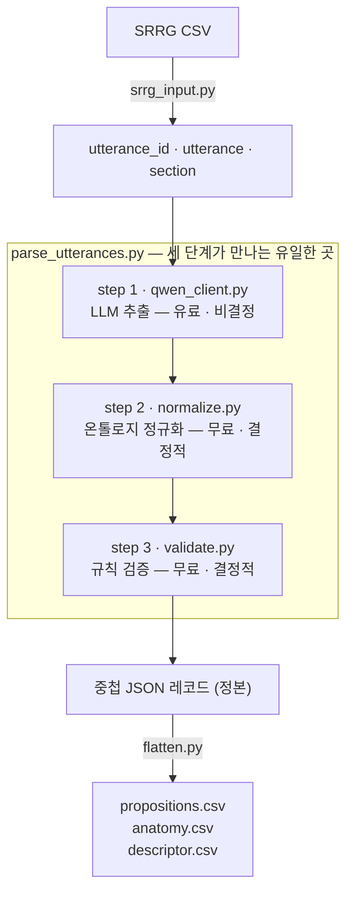

# Pipeline — 실제로 돌아가는 코드

> **한 줄 요약: 문장을 넣으면 표가 나오는 기계.** 일꾼 셋(① AI · ② 사전 ·
> ③ 검사관)이 여기 다 있습니다. **데이터 파일에 쓰는 코드는 이 폴더뿐**입니다
> (`Verify/` 는 읽기만 합니다).
>
> | 파일 | 하는 일 |
> |---|---|
> | `qwen_client.py` | ① AI에게 문장을 보낸다 |
> | `normalize.py` | ② 사전으로 표기를 통일한다 |
> | `validate.py` | ③ 규칙 어긴 곳을 찾는다 |
> | `parse_utterances.py` | 위 셋을 순서대로 부른다 (**실제로 실행하는 파일**) |
> | `extract_split.py` | 데이터 한 덩이를 통째로 다시 뽑는다 (13시간) |
> | `renormalize.py` | 사전만 다시 씌운다 (**AI 안 부름, 몇 분**) |

명세 Section 8 의 세 단계와 그 주변 도구. **이 저장소에서 `jsonl/` 에 쓰는 코드는
전부 여기 있다** (`Verify/` 는 설계상 절대 쓰지 않는다).



**한 문장에 서버 호출이 정확히 한 번.** step 2·3 은 로컬이고 결정적이고 공짜다.
그래서 **표로 판정할 수 있는 것은 전부 2·3 단계로 미룬다** — 모델에게 시키면
비싸고 흔들린다.

---

## 파일

### 파이프라인 본체

| 파일 | 단계 | 하는 일 |
|---|---|---|
| `srrg_input.py` | 입력 | SRRG CSV / JSONL / `--text` → `{utterance_id, utterance, section}` |
| `qwen_client.py` | **1** | 로컬 Qwen 서버 호출. **서버와 통신하는 유일한 파일** |
| `normalize.py` | **2** | `Prompt2/ontology.py` 표를 적용. 라벨·편측성·zone·섹션 정규화 |
| `validate.py` | **3** | 명세 15개 규칙에 대한 44개 검사 + review trigger 7종 |
| `parse_utterances.py` | 드라이버 | 위 넷을 잇는다. 실제로 실행하는 것은 이 파일 |
| `flatten.py` | 후처리 | 중첩 JSON → proposition / anatomy / descriptor 테이블 |

### 도구

| 파일 | 하는 일 |
|---|---|
| `renormalize.py` | 이미 만들어진 `jsonl/` 에 step 2 를 다시 적용 (고정점 만들기) |
| `radlex_import.py` | RadLex OWL → 납작한 TSV |
| `radlex_match.py` | 우리 라벨 ↔ RadLex 개념 대조 (방향 A) |
| `radlex_blindspot.py` | RadLex 에 있는데 한 번도 안 뽑은 개념 찾기 (방향 B) |

---

## 실행

```bash
cd Pipeline

python3 parse_utterances.py --check                        # 서버만 확인
python3 parse_utterances.py --dry-run --limit 5            # 무엇이 나갈지만
python3 parse_utterances.py --text "No pleural effusion." --section Pleura
python3 parse_utterances.py --limit 100                    # CSV 앞 100행
python3 parse_utterances.py --all                          # 전부
python3 parse_utterances.py --selftest                     # 서버 없이 step 2·3 만
python3 parse_utterances.py --dump-prompt OUT.md      # 나가는 프롬프트 전문
```

**어느 프롬프트로 뽑을지는 환경변수가 정한다.** 기본은 v1 이다.

```bash
REPORTCXR_PROMPT=Prompt2 python3 parse_utterances.py --jsonl subset.jsonl --yes
```

프롬프트는 갈리지만 **스키마와 표는 하나다** — `qwen_client.py` 는 스키마와 도구
이름을 항상 `Prompt2` 에서 가져오고, step 2·3 도 `Prompt2` 의 표를 읽는다.
어느 프롬프트로 뽑았든 산출물의 모양이 하나여야 비교가 성립한다.

산출물은 `--out`(기본 `./out_parse`)에 run id 를 공유하며 함께 떨어진다 —
레코드 JSON, 평탄화 CSV 3종, API 호출 로그.

**서버가 먼저 떠 있어야 한다.** `../Serving/README.md` 참조
(llama.cpp, `Qwen3.8-27B-UD-Q8_K_XL.gguf`, 1080 Ti 4장 분할).

### 다른 프롬프트로 한 split 을 다시 뽑기

```bash
python3 extract_split.py --split test_reviewed --arm Prompt2     # -> jsonl/Prompt2/
python3 extract_split.py --split test_reviewed --arm Prompt2 --limit 1   # 한 study 만
```

입력은 언제나 `jsonl/Prompt/<split>.jsonl` 의 발화이고, 바뀌는 것은 프롬프트뿐이다
(표·정규화기·검증기는 팔마다 같다). **이어서 돌린다** — 이미 끝난 study 는 건너뛰므로
13시간짜리 실행이 끊겨도 다시 실행하면 그 자리에서 계속된다.

### 이미 만들어진 데이터를 다시 정규화

온톨로지를 고친 뒤에는 **step 1 을 다시 돌릴 필요가 없다.** step 2 만 다시 적용한다.

```bash
python3 renormalize.py --dry-run       # 무엇이 바뀔지만
python3 renormalize.py                 # 실제 적용
```

안전장치 다섯이 걸려 있고 하나라도 실패하면 쓰지 않는다 —
백업 확인 · normalize.py drift 확인 · 스키마 보존 · 지표 C 보존 · 원자적 쓰기.

---

## 알아야 할 설계 결정 넷

### 1. `history_section` 을 프롬프트에 넣지 않는다

SRRG CSV 에 임상 병력 컬럼이 있지만 `srrg_input.py` 는 읽지 않는다.
병력은 **의뢰의가 의심한 것**이지 이 영상이 보여주는 것이 아니다. 프롬프트에
들어가면 `"history of pneumonia"` 가 pneumonia 명제가 된다. 명세 rule 3 이
"원문에 없는 텍스트에 기대는 명제"를 금지하는 것과 같은 이유다.

### 2. `OPENAI_*` 환경변수를 의도적으로 읽지 않는다

셸에 남아 있는 유료 키로 이 파서가 과금하는 일이 없도록. 다른 곳을 가리키려면
`--base-url` / `--model` 로 명시한다.

### 3. 샘플러를 고정한다 (temperature 0, top_p 1, top_k 1, seed 0)

구조화 추출이므로 같은 문장은 같게 답해야 한다. **다만 보장은 아니다** —
`qwen_client.py` 주석에 이 호스트에서 관측된 같은 seed·같은 프롬프트의 불일치
사례가 적혀 있다.

### 4. 중첩 JSON 이 정본이고 CSV 는 투영이다

`flatten.py` 는 테이블을 **대신** 쓰는 게 아니라 **옆에** 쓴다. 중첩 구조가
각 factor 를 entity 에 붙들어 두는 것이 rule 1 의 요점이고, 테이블은 세기 위한
projection 일 뿐이다.

---

## 온톨로지와의 관계

`normalize.py` 와 `validate.py` 는 `Prompt2/ontology.py` 를 읽는다. **저장소가
여럿일 때 이것이 조용히 어긋나는 것이 이 프로젝트에서 가장 비싼 실수였다.**

- `Verify/metrics/m03_fixed_point.py` 는 외부 체크아웃의 `normalize.py` 를
  로드할 수 있지만, 패키지 경로를 **append** 하므로 온톨로지는 항상 이 저장소 것이다
- `renormalize.py` 는 사용할 정규화기가 동결본과 다르면 `--allow-drift` 없이 거부한다
- 모든 검증 리포트 첫머리에 지문 표 셋(표 내용 해시 · 정규화기 코드 해시 ·
  데이터 파일 해시)이 찍힌다. **지문이 다른 리포트는 비교 대상이 아니다**

경로 규약 — 프롬프트 패키지는 한 단계 위에 있다. `qwen_client.py` 와
`parse_utterances.py` 가 sys.path 에 둘을 넣는다:

```python
_HERE = os.path.dirname(os.path.abspath(__file__))
sys.path.insert(0, _HERE)                     # 형제 모듈 (normalize, validate …)
sys.path.insert(0, os.path.dirname(_HERE))    # 저장소 루트의 Prompt / Prompt2
```

`Verify/metrics/m03_fixed_point.py` 의 `DEFAULT_NORMALIZE` 도 이 디렉터리를
가리킨다.

---

## 관련 문서

| | |
|---|---|
| [`../Start.md`](../Start.md) | **목적별 실행 안내 — 어디서부터 칠지 모르겠으면 여기** |
| [`../Glossary.md`](../Glossary.md) | 기호 사전 — step·rule·E1~E3·노트 코드 |
| [`../PROVENANCE.md`](../PROVENANCE.md) | 무엇이 정본인지, 체크섬, 미해결 질문 |
| [`../Serving/README.md`](../Serving/README.md) | Qwen 서버 띄우기 |
| [`../Verify/README.md`](../Verify/README.md) | 만들어진 데이터를 검증하는 12개 섹션 |
| [`../Prompt2/README.md`](../Prompt2/README.md) | v2 프롬프트와 표 |
