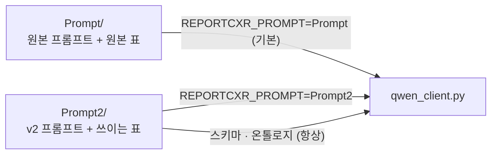

# Prompt — 첫 번째 지시서 (보관용)

> **한 줄 요약: AI에게 줬던 맨 처음 지시서입니다. 지금은 안 씁니다.**
> 새 지시서가 정말 나아졌는지 **비교할 기준**으로만 남겨 둡니다.
> **고치면 안 됩니다** — 고치는 순간 기준이 사라집니다.
> 지금 쓸 것은 `Prompt2` 입니다.

처음 쓰던 프롬프트를 **원본 그대로** 보존하는 자리다. A/B 의 v1 팔이 이 패키지를 쓰고, 그 외에는 아무것도 이것을 읽지 않는다.

`ontology.py` · `vocabulary.py` 도 원본 표가 들어 있지만 **실행에는 쓰이지
않는다.** step 2·3 과 `Verify/` 가 읽는 표는 `Prompt2/` 것이다.



## 파일

| 파일 | 명세 절 | 무엇 |
|---|---|---|
| `system.py` | 3 | 시스템 프롬프트 (문자열 하나) |
| `schema.py` | 2 | 도구 호출 JSON Schema. 구조의 **정본** |
| `user_template.py` | 4 | 사용자 메시지와 렌더링 |
| `examples.py` | 5, 6 | few-shot 예시 8개 |
| `selection.py` | 7 | 발화마다 어느 예시를 붙일지 |
| `vocabulary.py` | 2의 enum | 원본 어휘 (E2 zone 없음) |
| `ontology.py` | 8의 step 2 | 원본 표 (E1/E3 이전) |

## 실행

이 패키지는 모델을 부르지도, 파일을 건드리지도 않는다. 실행은 `Pipeline/` 에서 한다.

```bash
cd Pipeline
python3 parse_utterances.py --text "No pleural effusion." --section Pleura   # v1 이 기본
python3 parse_utterances.py --dump-prompt OUT.md                       # v1 전문을 파일로
```

```python
from Prompt import SYSTEM_PROMPT, PROPOSITIONS, TOOL_NAME, select
```

## 손대지 말 것

프롬프트 문자열과 표의 **내용**은 원본 그대로여야 한다. 이것이 바뀌면 v1 팔이
더 이상 "원래 쓰던 프롬프트"가 아니고 A/B 의 기준선이 사라진다. 고칠 것이 있으면
`Prompt2/` 에서 고친다.

현재 sha256 은 `PROVENANCE.md` §4 에 적혀 있다 (2026-09-14 주석 정리 후 값).

```bash
sha256sum Prompt/ontology.py
# 9bab6a0dd2091e74cf2b51076dda211042a9ab5ea188bf1c5258f3e8bb99597c
```
