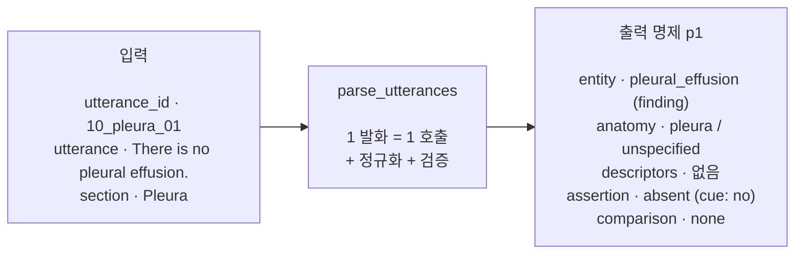
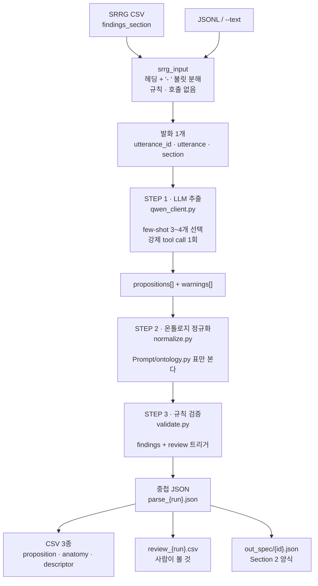

# ReportCXR2 — SRRG utterance 5-category proposition parser

> **브랜치 `ReportCXR2` — 2세대 (2026-08, 보관용).** 현재 개발본은 [`main`](https://github.com/DH82/ReportCXR/tree/main) 브랜치(ReportCXR-Ko)다.
> 이 브랜치는 *한 발화 = 명제 0~n개* 파서의 첫 판이며, main 의 `Pipeline/`·`Prompt/` 가 여기서 이어진다.
> 본문이 가리키는 `MD/` 명세 문서와 `out_*` 산출물은 저장소에 포함하지 않는다.

판독문의 **발화 한 줄**을 읽어, 그 줄이 말하는 **명제(proposition)** 를 뽑는다.
명제 하나는 다섯 축이 **서로 묶인 채로** 들어 있는 단위다.



핵심 성질 네 가지:

| | |
|---|---|
| **1발화 = 명제 0~n개** | 한 줄이 여러 소견을 말하면 명제가 여러 개 나온다. 버려지는 소견이 없다 |
| **다섯 축이 명제마다 묶인다** | `small`이 어느 소견에 붙었는지가 보존된다. 라벨 다섯 무더기가 아니다 |
| **호출은 발화당 1회** | 중첩 JSON 전체가 한 번에 나온다. 강제 tool call이라 스키마를 벗어날 수 없다 |
| **모델 뒤에 결정론적 2단계** | 온톨로지 정규화 → 규칙 검증. 표만 보고 판단하며 호출이 없다 |

근거 문서: [`MD/Ko-SRRG_CXR_5category_parser_simple.md`](MD/Ko-SRRG_CXR_5category_parser_simple.md).
아래에서 **rule N** 은 그 문서 §3의 규칙 번호, **Section N** 은 절 번호다.
연구 맥락은 [`MD/Ko-plan.md`](MD/Ko-plan.md).

### `ReportCXR`(MAPLEZ)과 무엇이 다른가

| | ReportCXR | **ReportCXR2** |
|---|---|---|
| 출력 단위 | 한 줄 = 소견 **하나** = 한 행 | 한 줄 = 명제 **0~n개** |
| 축의 관계 | 축 4개가 한 소견에 평평하게 붙음 | 축 5개가 **명제마다** 묶임 (rule 1) |
| 호출 수 | 축마다 1회 = 불릿당 최대 5회 | **발화당 1회** |
| 해석 분리 | 없음 | opacity(present) / pneumonia(uncertain, `derived_from`) (rule 6) |
| 사후 처리 | 위치 키워드 규칙 | **정규화 + 검증 + review 큐** (Section 8) |
| 백엔드 | OpenAI API | 로컬 llama.cpp (Qwen3.8-27B) |

---

## 1. 저장소 구성

**명세의 한 절 = 파일 하나.** 명세가 바뀌면 어디를 고쳐야 하는지가 자명해야 한다.

```
ReportCXR2/
│
├── parse_utterances.py       621줄  드라이버. 유일한 진입점
│
├── qwen_client.py            558줄  [step 1] 서버와 말하는 유일한 파일
├── normalize.py              608줄  [step 2] 결정론적 온톨로지 정규화
├── validate.py               444줄  [step 3] 규칙 검증 + review 트리거
├── flatten.py                156줄  중첩 JSON → CSV 3종 + 검토 큐
├── srrg_input.py             281줄  디스크 → Section 1 객체
│
├── Prompt/                          API로 나가는 모든 것 (단방향)
│   ├── __init__.py            60줄  재수출만. 로직 없음
│   ├── system.py             114줄  [Section 3]   system 메시지
│   ├── schema.py             144줄  [Section 2]   tool 파라미터 스키마
│   ├── user_template.py       81줄  [Section 4]   user 메시지 조립
│   ├── examples.py           367줄  [Section 5·6] few-shot 8종
│   ├── selection.py          126줄  [Section 7]   발화별 3~4개 선택
│   ├── vocabulary.py          60줄  닫힌 값 집합 (enum)
│   └── ontology.py           785줄  정규화 룩업표 — API로 안 나감
│
├── cxr_prompt.py                    [단독판] 프롬프트 전부. 이 파일엔 프롬프트만
├── cxr_run.py                       [단독판] 그것을 서버에 던지는 실행기
│
├── Qwen/                            서빙 환경 (Dockerfile · run.sh)
├── MD/                              명세 · 연구 계획 · 프롬프트 전문
│   ├── Ko-SRRG_CXR_5category_parser_simple.md   명세
│   ├── Ko-plan.md                               연구 계획
│   └── PROMPT.md                    ← 모델에 실제로 들어가는 것 전부 (생성물)
├── out_parse/                       실행 결과 + logs/
├── out_spec/                        id별 Section 2 파일
└── README.md                        ← 이 파일
```

파이썬 코드는 최상위 6개 + `Prompt/` 8개로 전부다.
`Prompt/` 안의 어떤 파일도 모델을 호출하지 않고 파일을 만지지 않는다. **의존은 단방향이다.**

### 두 갈래

| | 파일 | 무엇을 하나 |
|---|---|---|
| **본판** | `parse_utterances.py` + `Prompt/` + `normalize.py` + `validate.py` | 추출 → 정규화 → 검증. 이 README가 설명하는 것 |
| **단독판** | `cxr_prompt.py` + `cxr_run.py` | 프롬프트 하나 + 실행기 하나. 모델의 답을 **그대로** 낸다 |

단독판은 프롬프트만 따로 떼어 쓰고 싶을 때를 위한 것이다. 규칙·예시·스키마가
`cxr_prompt.py` 한 파일에 합쳐져 있고 `{utterance}` 같은 `{}` 자리만 채우면 된다.
정규화도 검증도 없으므로, `small`이 severity로 오든 라벨이 실행마다 흔들리든
그대로 나온다. 그 두 단계가 필요하면 본판을 쓸 것. → [§17](#17-단독판-cxr_promptpy--cxr_runpy)

---

## 2. 전체 파이프라인



**왜 나눴는가.** 모델에게 물어야만 아는 것(무엇이 명제인가)과, 표만 보면 아는 것
(`small`은 size인가 severity인가)은 다른 문제다. 후자를 모델에게 맡기면 호출마다 답이
흔들리고, 흔들린 답은 diff가 되지 않는다.

각 호출은 **독립적**이다. 모델은 매번 발화 하나만 보고, 같은 보고서의 다른 발화도
이전 답변도 보지 못한다.

---

## 3. 명제란 무엇인가

rule 1이 이 저장소의 존재 이유다.

> Do not output five separate bags of labels. Keep all factors linked to the correct entity.

`Small left pleural effusion and mild right basilar atelectasis` 를
`{small, mild} × {left, right} × {effusion, atelectasis}` 로 흩뿌리면
**어느 쪽이 small이었는지**가 사라진다. `MD/Ko-plan.md`가 측정하려는 binding 실패가
파서 단계에서 먼저 일어나는 것이다. 그래서 출력 단위는 라벨 목록이 아니라 명제다.

한 발화가 명제 **0개, 1개, 여러 개**를 만들 수 있다 (rule 2).

| 발화 | 명제 | 왜 |
|---|---|---|
| `No pleural effusion or pneumothorax.` | **2개** | 부정 하나가 둘 다에 걸린다 |
| `Multifocal consolidation in the right upper and lower lobes.` | **1개** | entity·assertion·descriptor가 같으면 anatomy 배열이 2칸 |
| `Opacity suggesting pneumonia` | **2개** | opacity=present, pneumonia=uncertain + `derived_from: p1` (rule 6) |
| `No large pleural effusion.` | 1개 + **warning** | large가 붙은 부정은 effusion 전체의 부정이 아니다 (rule 11) |
| `No significant changes noted` | **0개** | 소견을 말하지 않는 문장. 0개가 정답이다 |

명제 하나의 구조 (Section 2):

```json
{
  "id": "p1",
  "entity":      { "text": "…", "label": "…", "type": "finding | disease | device | …" },
  "anatomy":     [ { "text": "…", "label": "…", "laterality": "…", "zone": "…",
                     "role": "site | insertion_site | tip_location | relative_location",
                     "source": "utterance | section_context | entity_semantics | linked_proposition" } ],
  "descriptors": [ { "text": "…", "type": "size | severity | … ", "label": "…" } ],
  "assertion":   { "label": "present | absent | uncertain | unknown", "cue": "…" },
  "comparison":  { "label": "new | improved | worsened | stable | resolved | none | unclear", "cue": "…" },
  "derived_from": "p1 | null"
}
```

`anatomy`와 `descriptors`만 배열인 이유: 하나의 소견이 여러 위치에 있을 수 있고(rule 2),
서로 다른 축의 수식어가 동시에 붙을 수 있다(rule 8). 나머지 셋은 명제당 하나뿐이다.

---

## 4. 입력

발화의 단위는 **SRRG 불릿 하나**다. 세 가지 경로가 있다.

### 4.1 SRRG CSV — 기본

```
findings_section 원문                          →  발화
─────────────────────────────────────             ────────────────────────────────
Lungs and Airways:                                #1 section=Lungs and Airways
- New pulmonary vascular cephalization               text=New pulmonary vascular …
- Mild interstitial pulmonary edema               #2 section=Lungs and Airways
                                                     text=Mild interstitial …
Pleura:                                           #3 section=Pleura
- No pneumothorax                                    text=No pneumothorax
```

`srrg_input.py:109` `split_bullets` 의 규칙 세 가지:

| 규칙 | 예 |
|---|---|
| `Name:` 형태의 줄이면 헤딩. 47자 상한 | `Lungs and Airways:` → 이후 불릿들의 `section` |
| `- ` `* ` `1.` 로 시작하면 새 발화. 기호는 제거 | |
| 헤딩도 불릿도 아니면 위 불릿의 이어진 줄 | 하드 랩된 문장을 다시 잇는다 |

**`utterance_id`** 는 `{row_id}_{섹션 슬러그}_{두 자리}` 로 유도된다
(`srrg_input.py:146` `utterances_from_row`). 호출 순서가 아니라 CSV에서 나오므로
**재실행해도 같다**. 이것이 파싱 결과를 원본 행에 되붙이는 유일한 키다.

```
mimic-00000002_lungs_airways_01
mimic-00000002_pleura_02
```

**`history_section` 은 읽지 않는다.** 명세 Section 1에 자리가 없고, rule 3이 발화에 없는
텍스트에 기댄 명제를 금한다. 임상 병력은 의뢰의가 의심한 것이지 이 영상이 보여주는 것이
아니다. 프롬프트에 들어가면 `history of pneumonia`가 pneumonia 명제가 된다.

### 4.2 JSONL — 고정된 평가 부분집합 재실행

한 줄에 Section 1 객체 하나. id를 준 대로 쓴다 (`srrg_input.py:217` `load_jsonl`).

### 4.3 `--text` — 한 문장만

```bash
python parse_utterances.py --text "No large pleural effusion." --section Pleura
```
---

## 5. STEP 1 — LLM 추출

발화당 정확히 1회. 요청의 모든 필드가 어느 파일에서 오는지:

```
POST http://localhost:8080/v1/chat/completions        ← `qwen_client.py:75` `BASE_URL`
│
├── model  "qwen3.8-27b"                              ← `qwen_client.py:76` `MODEL`
│
├── messages[0] "system"
│   └── 규칙 15개 전문 (3,119자, 매 호출 동일)          ← `Prompt/system.py:22` `SYSTEM_PROMPT`
│
├── messages[1] "user"  (3,141자, few-shot 3개일 때)
│   ├── "Worked examples…"                            ← `Prompt/user_template.py:43` `_HEADER`
│   ├── Example 1~3 — 어느 것을 보낼지                  ← `Prompt/selection.py:90` `select`
│   │   └── 예시 본문 8종 중 선택                       ← `Prompt/examples.py:358` `EXAMPLES`
│   │       └── 렌더링                                 ← `Prompt/user_template.py:58` `render_example`
│   └── 대상 발화 3필드 JSON                            ← `Prompt/user_template.py:51` `input_block`
│
├── tools[0].function.name        "return_propositions" ← `Prompt/schema.py:39` `TOOL_NAME`
├── tools[0].function.parameters  중첩 스키마            ← `Prompt/schema.py:118` `PROPOSITIONS`
│   └── enum 값 집합                                    ← Prompt/vocabulary.py
├── tool_choice  "required"                             ← qwen_client.py (llama.cpp 대응)
│
├── temperature 0 / top_p 1 / seed 0                    ← `qwen_client.py:83` `TEMPERATURE`
├── max_tokens  2048                                    ← `qwen_client.py:87` `MAX_TOKENS`
└── extra_body: top_k 1 · cache_prompt · thinking off   ← `qwen_client.py:249` `extra_body`
```

> 아래 세 절이 설명하는 것의 **전문**은
> [`MD/PROMPT.md`](MD/PROMPT.md)에 한 파일로 있다 — system 메시지, tool 스키마,
> few-shot 8종, 완성된 요청 한 건. `--dump-prompt`로 모듈에서 직접 생성하므로
> 코드와 어긋나지 않는다.

### 5.1 system 프롬프트 — Section 3

| | |
|---|---|
| 파일 | `Prompt/system.py:22` `SYSTEM_PROMPT` |
| 크기 | 3,119자. **매 호출 바이트까지 동일** → KV 캐시에 남는다 |
| 내용 | 명세 Section 3 축자 (규칙 15개) |

명세에서 바꾼 것은 두 곳뿐이고 파일 docstring에 적혀 있다:

1. rule 15의 "Return JSON only"는 유지하되, 실제로는 강제 tool call이 보장한다
2. `utterance_id`/`utterance`/`section` 에코 지시를 뺐다 → `OUTPUT SHAPE` 절이 대신 들어감

규칙 15개가 강제하는 것 중 파이프라인이 실제로 검사하는 것:

| rule | 내용 | 어디서 강제되나 |
|---|---|---|
| 1 | 축을 명제에 묶어라 | 스키마 구조 자체 |
| 2 | 명제는 0~n개 | 스키마 (배열) |
| 3 | text·cue는 **원문 그대로** | `validate.py:114` `check_spans` — 부분문자열 대조 |
| 4 | 헤딩은 약한 맥락. laterality·zone 금지 | `normalize.py:307` `_apply_section_context_rule` |
| 6 | 소견과 해석을 분리 | `derived_from` + `validate.py:150` `check_shape` |
| 9 | size와 severity를 섞지 마라 | `normalize.py:387` `normalize_descriptor` — 사전이 축을 결정 |
| 10 | assertion 4값 + cue | `validate.py:234` `check_rules` |
| 11 | 한정된 부정을 보존 | `validate.py:234` `check_rules` — 경고 |
| 12 | comparison 7값. resolved → absent | `normalize.py:541` `apply_resolved_rule` |
| 13 | chronic·known은 비교가 아니다 | `normalize.py:511` `normalize_comparison` — descriptor로 이동 |
| 14 | 정상 서술은 anatomical_state | `validate.py:234` `check_rules` — 경고 |

### 5.2 tool 스키마 — Section 2

명세의 주석 달린 예시를 실제 JSON Schema로 옮긴 것. 이 백엔드에서 스키마는 문서가 아니라
**llama.cpp가 GGBNF 문법으로 컴파일하는 대상**이라, 여기서 느슨하면 모델이 틀릴 자유가 생긴다.

| 심볼 | 내용 |
|---|---|
| `Prompt/schema.py:99` `PROPOSITION` | 명제 1개 = 다섯 축 + id + derived_from |
| **`Prompt/schema.py:118` `PROPOSITIONS`** | **호출 1회가 반환하는 것** = `propositions[]` + `warnings[]` |
| `Prompt/schema.py:130` `FULL_RECORD` | Section 2 전체 객체 (디스크에서 읽은 레코드 검사용) |

`PROPOSITIONS`에 `utterance_id`/`utterance`/`section`이 **없다.** 모델이 되돌려 주지 않고
`parse_utterances.py:70` `parse_one`이 입력에서 다시 붙인다. 출력 토큰을 아끼는 것보다,
rule 3의 "exact input text"가 모델의 오타로 깨질 수 없게 만드는 것이 중요하다.

nullable 필드는 `{"type": ["string","null"]}` 대신 **null을 포함한 enum**으로 쓴다.
llama.cpp가 둘 다 처리하지만, enum이면 값 집합이 한자리에 고정된다.

### 5.3 few-shot 선택 — Section 7

전부 보내는 것이 더 나쁘다. 명세 Section 6이 명시한다.
`Prompt/selection.py:90` `select` 가 발화마다 3~4개를 고른다.

```
[1] basic                                     항상  (기본 부정)
[2] qualified (부정이 있으면) / multi_location  항상
[3] CUE_TABLE 에서 처음 걸리는 것                cue
[3'] 아무 cue도 안 걸리면 always 쌍의 나머지 반쪽  폴백
```

`Prompt/selection.py:44` `CUE_TABLE` — **표의 순서가 곧 우선순위**다. 순서를 고정하지 않으면
`temperature 0` 도 `seed 0` 도 의미가 없다:

| cue | 보내는 예시 |
|---|---|
| `suggesting` `likely` `cannot exclude` `or` | `inference` — 소견 1 + 해석 3 |
| `tip` `terminates` `SVC` `carina` | `device` — insertion_site vs tip_location |
| `upper and lower` `bilateral` | `multi_location` — anatomy 배열 2칸 |
| `new` `unchanged` `stable` `improved` | `temporal` — cue → comparison |
| `normal` `clear` `within normal limits` | `normal` — anatomical_state |

cue는 **단어 경계**로 맞춘다 (`Prompt/selection.py:75` `_hit`). `or`가 `aorta`에 걸리면 안 된다.

few-shot 8종 (`Prompt/examples.py:358` `EXAMPLES`):

| 이름 | 가르치는 것 | 출처 |
|---|---|---|
| `basic` | 부정 1개, 명제 1개 | Section 5 |
| `negation_multi` | 부정 1개가 entity 2개에 걸림 | rule 2 |
| `qualified` | 부정 + size → warning | Section 6 A |
| `multi_location` | entity 1개, anatomy 2칸 | Section 6 B |
| `device` | insertion_site vs tip_location | Section 6 C |
| `inference` | 관찰 1 + 해석 3, `derived_from` | Section 6 D |
| `temporal` | cue → comparison | rule 12에서 유도 |
| `normal` | 정상 서술 = anatomical_state | rule 14에서 유도 |

Section 6 A~C는 명세의 JSON 그대로다. **D는 명세에 산문 4줄로만 있어** 이 저장소가
Section 2 스키마로 인코딩했고, 그때 채운 두 자리는 `Prompt/examples.py:214` `NOTE_D` 에 적혀 있다.
`temporal`·`normal`은 Section 7이 cue로 고르지만 Section 6이 쓰지 않아 규칙에서 유도했다.

**few-shot을 이전 assistant 턴이 아니라 user 메시지 안에 넣는 이유**: tool 모드에서 이전
assistant 턴은 tool_call 메시지여야 하고 그 렌더링이 모델마다 다르다. 잘못 렌더링된 예시는
**조용히 잘못된 것을 가르친다**.

### 5.4 백엔드 설정과 그 이유

```json
{ "base_url": "http://localhost:8080/v1", "response_mode": "tool", "thinking": "off",
  "temperature": 0.0, "top_p": 1.0, "top_k": 1, "seed": 0,
  "max_tokens": 2048, "workers": 1,
  "server": { "model_alias": "qwen3.8-27b", "n_ctx": 32768,
              "build_info": "b10631-5d5cb4c3a", "total_slots": 1 } }
```

| 값 | 이유 |
|---|---|
| `temperature 0 / top_p 1 / top_k 1 / seed 0` | 구조화 추출이다. 샘플러를 변수에서 제거한다 |
| `thinking off` | Qwen3.8 chat template이 기본으로 켠다. `--thinking`으로 되돌릴 수 있다 |
| **`max_tokens 2048`** | ReportCXR의 1024보다 크다. 거기서는 축 하나의 짧은 답이지만 여기서는 중첩 레코드 전체가 한 번에 나온다. **잘린 응답은 부분 답이 아니라 파싱 불가 응답**이라 `finish_reason=="length"`를 에러로 올린다 |
| `workers 1` | 서버가 `--parallel 1`. 둘을 같이 올리거나 둘 다 두거나 |
| `cache_prompt` | system 프롬프트가 매 호출 동일하므로 KV 캐시에 남는다. few-shot 블록은 발화마다 달라서 안 남는다 |

`OPENAI_*` 환경변수는 **읽지 않는다.** 쉘에 남은 유료 키가 이 파서 때문에 과금될 수 없다.

**재현성은 보장이 아니다.** 같은 프롬프트·`seed 0`인데도 실측에서 한 번은
`pulmonary_vessels`, 다음 실행은 `pulmonary_vascular`가 나왔다. llama.cpp가 4장에 걸쳐
reduce하고 KV 캐시를 재사용하므로 bit 단위 재현이 되지 않는다. **두 실행을 비교 가능하게
만드는 것은 greedy decoding이 아니라 STEP 2의 정규화다.** 실행마다 흔들리는 라벨은
`Prompt/ontology.py`의 공백이지 온도를 올릴 이유가 아니다.

### 5.5 답을 받는 세 가지 경로

`qwen_client.py:289` `parse` 는 순서대로 시도한다:

| 순서 | 방법 | 언제 |
|---|---|---|
| 1 | 강제 tool call (`tool_choice="required"`) | 기본. llama.cpp가 스키마를 문법으로 컴파일 |
| 2 | `response_format=json_schema` | 서버가 tool call을 못 할 때. **경로만 다른 같은 문법** |
| 3 | 응답 본문에서 JSON 긁기 (`qwen_client.py:148` `extract_json`) | 마지막 수단 |

`mode="auto"`는 tool로 시작하고, 엔드포인트가 처음 거부하면 **그 실행 내내** json 모드로
전환한다(한 번 거부하면 매번 거부하므로). 전환 시 stderr에 `[info] switching to json mode`.

llama-server는 `tool_choice`를 **문자열로만** 파싱한다. OpenAI의 객체 형태
(`{"type":"function","function":{...}}`)를 주면 조용히 `"auto"`로 떨어지고, 호출을 강제하던
문법이 사라진다. 도구가 하나뿐이므로 `"required"`가 그것을 가리킨다.
---

## 6. STEP 2 — 온톨로지 정규화 (호출 없음)

`Prompt/ontology.py`의 표만 본다. 호출 없음, 난수 없음, 같은 입력이면 같은 출력.

모델은 "canonical_snake_case"를 언어 모델이 할 수 있는 만큼 해 준다. 이 단계가 그 주장을
**사실로** 만든다.

```
모델의 답                                    정규화 후
────────────────────────────────            ────────────────────────────────
label "Effusion"                            pleural_effusion
label "lower lobe" + laterality right       right_lower_lobe  (zone: lower)
descriptor "Small" type=severity            type=size  label=small        ← rule 9
comparison "stable" cue="chronic"           comparison=none
                                            + descriptor chronicity=chronic  ← rule 13
entity "pneumonia" type=finding             type=disease                   ← rule 6
anatomy.text "pleural" (발화에 없음)          text=null, source=entity_semantics ← rule 3
```

`normalize.py:557` `normalize_record` 가 순서대로 부르는 것:

| 함수 | 대상 |
|---|---|
| `normalize.py:160` `normalize_entity` | snake_case → `ENTITY_ALIASES`. rule 6 타입 교정 |
| `normalize.py:195` `normalize_anatomy` | alias → 좌우 결합 → 빈 laterality·zone 채우기 → rule 4 강제 |
| `normalize.py:326` `drop_unsupported_spans` | **rule 3**: 발화에 없는 `anatomy.text`는 null + `entity_semantics` |
| `normalize.py:359` `fill_section_anatomy` | rule 4: 비어 있는 broad anatomy만. derived 명제는 건너뜀 |
| `normalize.py:387` `normalize_descriptor` | **rule 9**: `DESCRIPTOR_LEXICON`이 축을 결정 |
| `normalize.py:448` `move_comparison_descriptors` | **rule 12** 역방향: `Stable`이 descriptor에 오면 이동 또는 중복 제거 |
| `normalize.py:511` `normalize_comparison` | cue 매핑 + rule 13 (chronic → chronicity descriptor) |
| `normalize.py:541` `apply_resolved_rule` | rule 12: `resolved` → assertion `absent` |
| `normalize.py:490` `repair_derived_from` | `"p1, p2"` 같은 답에서 존재하는 첫 id만 남긴다 |

### 하는 일과 하지 않는 일

**하지 않는 일: 모델이 판단한 assertion을 뒤집지 않는다.** 부정 cue가 `present`에 붙어
있으면 바꾸지 않고 note만 남기고, `validate.py`가 error로 올린다. 둘 중 뭐가 맞는지 고르는
것은 이 단계에 허용된 판단이 아니다.

이 경계는 실제로 두 번 시험됐다.

| 시도 | 결과 |
|---|---|
| `anatomy.text`가 발화에 없으면 null + `entity_semantics` | **유지.** 라벨은 맞고 "발화가 그렇게 말했다"는 주장만 거짓이다. Section 2에 이미 그 슬롯이 있다 |
| 방향어만 있는 라벨(`bilateral`)을 섹션의 broad anatomy로 채우기 | **철회.** 측은 발화의 한 부분에서, 구조는 다른 부분에서 와 `lungs`+`midline` 같은 **자기모순 라벨을 수리가 만들어냈다.** 커버 안 된 라벨은 공백이지만 모순된 라벨은 거짓 진술이다 |

바꾼 것은 전부 `record["normalization"]`에 `{code, proposition, field, from, to}`로 남는다.
원본 응답을 따로 보관하지 않아도 diff가 된다.

### 표 (`Prompt/ontology.py`)

| 표 | 크기 | 역할 |
|---|---|---|
| `SECTIONS` | 8 | SRRG 헤딩 8개 → broad anatomy + **양립 가능한** anatomy 그룹 |
| `ANATOMY` | 147 | 정규 라벨 → (laterality, zone, group) |
| `ANATOMY_ALIASES` | 110 | 표면형 → 정규 라벨 |
| `LATERALIZABLE` | 27 | `lower_lobe` + right → `right_lower_lobe` |
| `ENTITY_ALIASES` | 56 | 동의어 통일 |
| **`DESCRIPTOR_LEXICON`** | **149** | **rule 9가 사는 곳.** small=size, mild=severity |
| `COMPARISON_CUES` | 37 | rule 12 |
| `NEGATION_CUES` / `UNCERTAINTY_CUES` | 16 / 23 | rule 10 |

`ANATOMY`의 laterality·zone은 **라벨이 함의하는 값**이지 발화가 말한 값이 아니다.
비어 있는 필드를 채우고, 모순을 잡는 데 쓴다. 라벨이 정하지 않는 것은 `None`으로 둔다 —
`stomach`를 "left"로, `mitral_valve`를 "left"로 적었다가 모델과 충돌해 되돌린 자리들이다.

---

## 7. STEP 3 — 규칙 검증 (호출 없음)

두 가지 다른 질문을 함께 답한다.

| | 질문 | 값 |
|---|---|---|
| **findings** | 이 레코드가 **틀렸는가** | `error` — 규칙 위반·발화에 없는 텍스트. 그대로 쓸 수 없다<br/>`warning` — 일관되지만 규칙이 짚고 넘어가는 것 |
| **triggers** | 사람이 **봐야 하는가** | Section 8의 7개. 맞는 레코드에서도 켜진다 |

트리거는 결함이 아니다. **오류가 몰리는 자리**이기 때문에 켠다.

```
two or more entities · qualified negation · uncertain interpretation
multiple anatomy locations · device tip location · temporal comparison
section conflict
```

### 검사 목록

| 함수 | 검사 |
|---|---|
| `validate.py:114` `check_spans` | **rule 3** — 모든 text·cue가 발화의 부분문자열인가 |
| `validate.py:150` `check_shape` | enum 소속 · id 중복 · `derived_from` 참조·순환 |
| `validate.py:234` `check_rules` | rule 4·6·7·9·10·11·12·13·14 |
| `validate.py:378` `review_triggers` | Section 8의 7개 트리거 |

가장 비싼 것은 **span 검사**다. rule 3이 "exact source text"를 요구하는 이유는 문서를
예쁘게 만들기 위해서가 아니다. paraphrase하는 파서의 span은 grounding에도, counterfactual
swap에도, annotator 간 일치도 측정에도 쓸 수 없다.

### 판단하지 않고 넘기는 것

`comparison_cue_mismatch`처럼 정규화가 **고치지 않고 note만 남긴** 것은 여기서 error가 된다.
설계상 한 곳에서만 판단한다: 표로 알 수 있으면 STEP 2가 고치고, 아니면 STEP 3이 올린다.

---

## 8. 값 집합

Section 2가 `"a | b | c"` 문자열로 쓴 것을 `Prompt/vocabulary.py`가 한 번만 정의한다.
스키마·정규화·검증이 모두 여기서 읽으므로 셋이 어긋날 수 없다.

| 상수 | 값 | Section 2의 필드 |
|---|---|---|
| `ENTITY_TYPES` | finding · disease · device · anatomical_state · postoperative_state · other | `entity.type` |
| `LATERALITY` | left · right · bilateral · midline · unspecified · not_applicable | `anatomy.laterality` |
| `ZONES` | upper · middle · lower · apical · basilar · perihilar · retrocardiac · diffuse · **null** | `anatomy.zone` |
| `ANATOMY_ROLES` | site · insertion_site · tip_location · relative_location | `anatomy.role` |
| `ANATOMY_SOURCES` | utterance · section_context · entity_semantics · linked_proposition | `anatomy.source` |
| `DESCRIPTOR_TYPES` | size · severity · extent · distribution · number · morphology · measurement · device_position · chronicity · normality · other | `descriptors[].type` |
| `ASSERTION_LABELS` | present · absent · uncertain · unknown | `assertion.label` |
| `COMPARISON_LABELS` | new · improved · worsened · stable · resolved · none · unclear | `comparison.label` |

축을 하나 추가한다는 것은 `vocabulary.py` **와** `schema.py` **와** `system.py`의 해당 규칙
문장을 같이 고친다는 뜻이다. 동의어를 하나 추가하는 것은 `ontology.py`만 고치면 된다.

**`zone`의 값들은 서로 배타적이지 않다.** `basilar`와 `lower`, `apical`과 `upper`는 같은
곳의 다른 이름이다. `ZONE_SYNONYMS`가 이 쌍들을 정의하고, 정규화가 라벨 쪽 값으로 접는다.
접히지 않는 쌍(`upper` vs `lower`)만 모순이다.
---

## 9. 출력

`./out_parse/`, 한 run이 5개 파일 + 로그 2개를 공유한다 (`{run}` = UTC 타임스탬프 + 6자리).

| 파일 | 1행/1레코드 = | 만드는 곳 |
|---|---|---|
| `parse_{run}.json` | **중첩 레코드.** 이것이 기록의 원본이다 | `parse_utterances.py:402` `write_outputs` |
| `propositions_{run}.csv` | 명제 1개 (18컬럼) | `flatten.py:42` `PROPOSITION_COLS` |
| `anatomy_{run}.csv` | anatomy 항목 1개 | `flatten.py:50` `ANATOMY_COLS` |
| `descriptors_{run}.csv` | descriptor 1개 | `flatten.py:55` `DESCRIPTOR_COLS` |
| `review_{run}.csv` | 트리거·error가 켜진 발화 1개 | `flatten.py:60` `REVIEW_COLS` |
| `logs/api_calls_{run}.jsonl` | 요청·응답 전문, 선택된 few-shot, 토큰, latency | `qwen_client.py:97` `CallLog` |

**중첩 JSON을 먼저 쓰고 테이블을 그것에서 뽑는다.** Section 8이 그렇게 하라고 하고,
평평해진 행은 다시 명제로 되돌릴 수 없기 때문이다.

anatomy와 descriptor가 별도 테이블인 이유: rule 2(entity 1개에 위치 여러 개)와
rule 8(타입 11개) 때문에 **컬럼이 될 수 없다**. 조인 키는 `(utterance_id, proposition_id)`.

`review_{run}.csv`는 데이터 테이블이 아니라 **큐**다. `MD/Ko-plan.md` §4.6이 요구하는
300~500 proposition 2인 검수의 표본 추출 입력이다.

### `parse_{run}.json` 안에 무엇이 있나

```
{ "meta": { run_id, spec, source, api_calls, input/output_tokens,
            backend {…},        ← qwen_client.backend_meta()
            summary {…} },      ← parse_utterances.summarize()
  "records": [
    { utterance_id, utterance, section,     ← Section 2 (입력에서 재부착)
      propositions[], warnings[],           ← Section 2 (모델 + 정규화)
      normalization[],                      ← STEP 2가 바꾼 것 전부
      review {},                            ← STEP 3의 findings + triggers
      row_id, bullet_index, elapsed_s } ] }
```

`normalization`이 있어서 원본 응답을 따로 보관하지 않아도 diff가 된다.
전문이 필요하면 `logs/api_calls_{run}.jsonl`에 요청·응답이 그대로 있다.

### 명세 양식으로만 뽑기

| 플래그 | 결과 |
|---|---|
| `--spec-json PATH` | Section 2의 **5개 키만** 담은 레코드의 JSON 배열, 한 파일 |
| `--spec-dir DIR` | 행마다 `DIR/{row_id}.json` |

`normalization`·`review`·`row_id`·타이밍은 들어가지 않는다. **그것들은 파서가 자기 자신에
대해 하는 말이지 파싱 결과가 아니다.** 감사 추적이 필요하면 같은 실행의 `parse_{run}.json`을
보면 된다.

### `--replay` — 모델 재호출 없이 STEP 2·3만

```bash
python parse_utterances.py --replay out_parse/logs/api_calls_{run}.jsonl
```

STEP 1은 발화당 25초지만 STEP 2·3은 표의 순수 함수라 공짜다. `ontology.py`에 행을 하나
추가했을 때 "그래서 뭐가 달라지나"의 답을 GPU 84분을 다시 태워서 얻을 이유가 없다.
로그에 응답 원문이 있으므로 그것을 다시 읽어 정규화·검증만 새로 돌린다.
**모델의 답은 손대지 않고 이 저장소가 그 답에 하는 일만 다시 한다.**

---

## 10. 워크스루 — 실제 실행 결과


> **공개용 처리** — 원 실행의 입력은 MIMIC-CXR 판독문이다. MIMIC 은 PhysioNet 자격 인증
> 데이터라 재배포할 수 없으므로, 공개 저장소에서는 행 id 를 `mimic-0000000N` 으로 가리고
> 일부 불릿 문장을 같은 소견의 다른 표현으로 바꿨다. 표·호출 수는 원 실행 기준이다.

입력은 CSV의 `mimic-00000002` 행. 9개 불릿 → 발화 9개 → 명제 9개.

```
findings_section
─────────────────────────────────────────────────────────
Lungs and Airways:
- New pulmonary vascular cephalization
- Mild interstitial pulmonary edema
- Right middle lobe atelectasis
Pleura:
- No pneumothorax
- No large pleural effusion
Cardiovascular:
- Mild chronic cardiomegaly
Hila and Mediastinum:
- Normal mediastinal contours
Abdominal:
- Multiple surgical clips in the left upper abdomen
Musculoskeletal and Chest Wall:
- Scoliosis of the thoracolumbar spine
```

**결과** (`propositions.csv` 요약)

| # | entity | type | anatomy | descriptors | assert | compare |
|---|---|---|---|---|---|---|
| 1 | `pulmonary_vascular_cephalization` | finding | pulmonary_vasculature | — | present | **new** |
| 2 | `interstitial_pulmonary_edema` | finding | lungs / bilateral | severity=mild | present | none |
| 3 | `atelectasis` | finding | right_middle_lobe / right | — | present | none |
| 4 | `pneumothorax` | finding | pleura ᶜ | — | **absent** | none |
| 5 | `pleural_effusion` | finding | pleura | **size=large** | **absent** | none |
| 6 | `cardiomegaly` | finding | heart ᵉ / midline | severity=mild, **chronicity=chronic** | present | none |
| 7 | `normal_mediastinal_contours` | **anatomical_state** | mediastinum / midline | normality=normal | present | none |
| 8 | `surgical_clips` | device | upper_abdomen | number=multiple | present | none |
| 9 | `scoliosis` | finding | thoracolumbar_spine | — | present | none |

ᶜ `source: section_context` (헤딩이 채움) · ᵉ `source: entity_semantics` (소견에서 알려진 위치)

읽는 법:

- **#5** — `large`가 size로 기록되고 assertion은 absent다. 여기에 warning이 붙는다:
  *"Qualified negation: smaller pleural effusion is not excluded."* (rule 11).
  큰 삼출이 없다는 것이지 삼출이 없다는 것이 아니다.
- **#6** — `chronic`이 comparison이 아니라 **chronicity descriptor**로 갔다 (rule 13).
  "만성"은 이전 검사와의 비교가 아니다.
- **#7** — "Normal mediastinal contours"가 `anatomical_state`이지, 종격동 질환 전체의
  부재가 아니다 (rule 14).
- **#4** — 발화가 위치를 말하지 않아 anatomy가 비어 있었고, 헤딩 `Pleura`가 broad anatomy
  `pleura`를 채웠다. 그래서 `source`가 `section_context`이고 `laterality`는
  `unspecified`다. **헤딩은 측이나 zone을 절대 채우지 않는다** (rule 4).
- **#6** — anatomy `heart`의 `source`는 `entity_semantics`다. 모델이 `text: "cardiac"`을
  적었지만 발화에 그 단어가 없어 span 주장이 떨어져 나갔다. 심비대가 심장의 것이라는 건
  참이지만 **발화가 그렇게 말하지는 않았다** (rule 3).

**호출 수** 9 (발화당 1회). 토큰 in 24,230 / out 1,626. 3.4분, 22초/call.
**트리거** 2건: `temporal comparison`(#1), `qualified negation`(#5).

명제가 여러 개 나오는 예:

```
"Linear opacity in the left lower lung suggestive of plate-like atelectasis."
  p1  linear_opacity (finding)          assertion=present     anatomy: left_lower_lobe/left
  p2  plate_like_atelectasis (disease)  assertion=uncertain   <- derived_from p1
```

rule 6이 작동한 것이다. 관찰(opacity)은 present, 그 해석(atelectasis)은 uncertain이며
`derived_from`으로 관찰에 묶여 있다. 해석이 anatomy를 물려받되 `source`는
`linked_proposition`이라, 그 위치가 자기 절에서 나온 것이 아님이 남는다.

---

## 11. 실측 — validate.csv 60행

앞의 30행으로 오류를 찾아 고치고, **다음 30행으로 그 수정을 검증**했다.
아래는 두 표본 합계 (수정 반영 후).

| | |
|---|---|
| 발화 | 338 |
| 명제 | 423 |
| 명제 분포 | 0개 1 · 1개 267 · 2개 56 · 3개 12 · 4개 2 |
| **error** | **6** (1.8%) |
| warning | 15 |
| 검토 큐 | 148 |

**남은 error 6건은 전부 모델의 rule 3 위반**이고, 결정론적으로 고칠 수 없다(고치려면
지어내야 한다):

| 발화 | 모델의 답 | 문제 |
|---|---|---|
| `A right … central catheter (PICC) line …` | text `PICC line` | 괄호를 건너뛰어 연속 span이 아님 |
| `No signs of advanced interstitial or alveolar edema.` | text `interstitial edema` | 등위 접속을 **합성**했다 |
| `Mildly tortuous and calcified aorta.` | text `tortuous aorta` | 같은 이유 |
| `No free air identified below the diaphragm.` | cue `No ... identified` | 생략부호로 이어 붙인 cue |

수정 전후 (같은 모델 응답, `--replay`로 재정규화):

| 검사 | 수정 전 (행 0–29) | 수정 후 (행 30–59, 미지 데이터) |
|---|---|---|
| `section_conflict` | 33 (**전부 오탐**) | 1 (진짜) |
| `zone_contradicts_label` | 3 | 0 |
| `laterality_contradicts_label` | 2 | 0 |
| `comparison_as_descriptor` | 4 | 0 |

무엇을 고쳤는지는 §14에 있다.

**트리거 분포** (Section 8의 7개, 338발화 기준)

| 트리거 | 건수 |
|---|---|
| two or more entities | 65 |
| temporal comparison | 65 |
| multiple anatomy locations | 30 |
| uncertain interpretation | 26 |
| qualified negation | 20 |
| device tip location | 13 |
| section conflict | 4 |
---

## 12. 실행

서버부터 띄운다 (자세한 것은 [`Qwen/README.md`](Qwen/README.md)):

```bash
cd /home/ldh/ReportCXR2/Qwen && ./run.sh -d
```

| 명령 | 하는 일 | 서버 |
|---|---|---|
| `python parse_utterances.py --selftest` | STEP 2·3을 명세의 정답에 대해 검사 | **불필요** |
| `python parse_utterances.py --check` | 서버 상태·모델·tool call 확인 | 필요 |
| `python parse_utterances.py --dry-run --limit 5` | 보낼 것 + 선택된 few-shot 출력 | **불필요** |
| `python parse_utterances.py --dump-prompt MD/PROMPT.md` | 전선에 나가는 프롬프트 전문을 한 파일로 | **불필요** |
| `python parse_utterances.py --replay LOG.jsonl` | 저장된 응답에 STEP 2·3만 다시 | **불필요** |
| `python parse_utterances.py --text "…" --section Pleura` | 한 문장 | 필요 |
| `python parse_utterances.py` | CSV 첫 행 | 필요 |
| `python parse_utterances.py --id mimic-00000002 --spec-json out/x.json` | 한 행, 명세 양식으로 | 필요 |
| `python parse_utterances.py --limit 30 --yes --spec-dir out_spec` | 30행, 행마다 한 파일 | 필요 |

50발화가 넘으면 `--yes`가 필요하다. 발화당 1회지만 25초/call이다.

### `--selftest` 가 검사하는 것

서버가 필요 없다. 명세의 정답(few-shot 8종)에 대해
**정규화가 아무것도 바꾸지 않고 검증이 아무것도 잡지 않는지**를 확인한다.
하나라도 걸리면 `ontology.py`의 표가 `system.py`의 프롬프트에서 떨어져 나온 것이고,
그 이후의 모든 파싱이 의심스럽다. 이어서 일부러 망가뜨린 레코드 4종이 잡히는지도 본다.

```
$ python parse_utterances.py --selftest
  basic            ok       normalization=[] findings=[] triggers=[]
  …
  -- deliberately broken records: each must be caught --
  invented span                caught  (entity_text_not_in_utterance)
  resolved not absent          caught  (resolved_implies_absent)
  laterality from the heading  caught  (section_context_laterality_dropped)
  dangling derived_from        caught  (derived_from_repaired)
  selftest passed
```

### `--dry-run` — 무엇이 나가는지

```
$ python parse_utterances.py --dry-run --limit 1
  mimic-00000001_lungs_airways_01 [Lungs and Airways]
      Linear opacity in the left lower lung suggestive of plate-like atelectasis.
      few-shot: basic, multi_location, inference
  mimic-00000001_pleura_01     [Pleura]
      No pleural effusion.
      few-shot: basic, qualified, multi_location
```

---

## 13. 무엇을 고칠 때 어디를 보나

| 하고 싶은 것 | 고칠 곳 |
|---|---|
| 프롬프트 문구 수정 | `Prompt/system.py` (명세 §3과 함께). 고친 뒤 `--dump-prompt`로 `MD/PROMPT.md` 재생성 |
| few-shot 예시 추가·수정 | `Prompt/examples.py` + `--selftest`로 확인 |
| 어떤 예시를 언제 보낼지 | `Prompt/selection.py`의 `CUE_TABLE` |
| **동의어 추가** (라벨이 미매핑) | `Prompt/ontology.py`의 `ANATOMY_ALIASES` / `ENTITY_ALIASES` 한 줄 |
| **수식어의 축 교정** (small이 severity로 옴) | `Prompt/ontology.py`의 `DESCRIPTOR_LEXICON` |
| 새 anatomy 라벨 | `ANATOMY` + 좌우가 갈리면 `LATERALIZABLE` (기본형도 `ANATOMY`에 넣을 것) |
| 축 값 추가/삭제 | `Prompt/vocabulary.py` **와** `Prompt/schema.py` **와** `system.py`의 해당 규칙 문장 |
| 검사 추가·완화 | `validate.py`의 `check_rules()` |
| 정규화 규칙 추가 | `normalize.py` + `normalize_record()`에 연결 |
| CSV 컬럼 조정 | `flatten.py`의 `*_COLS` |
| 모델·서버·샘플링 | `qwen_client.py` 상단 CONFIG |
| CSV 경로·컬럼명 | `srrg_input.py` 상단 CONFIG |

**고친 뒤에는 `--selftest`, 그다음 `--replay`.** 표를 고쳤을 때 실제 데이터에서 무엇이
달라지는지는 재호출 없이 초 단위로 확인된다.

---

## 14. 설계상 알아둘 것

1. **정규화는 사실을 고치지 판단을 고치지 않는다.**
   `small`이 어느 축인지는 표가 정한다. 소견이 있는지 없는지는 모델이 정한다.
   근거가 어긋나면 정규화는 note만 남기고 검증이 error로 올린다.

2. **수리가 모순을 만들면 그 수리는 틀린 것이다.**
   방향어만 있는 라벨(`bilateral`)을 섹션의 구조로 채웠더니 `lungs`+`midline` 같은
   자기모순 라벨이 나왔다. 되돌렸다. **커버 안 된 라벨은 공백이지만 모순된 라벨은
   거짓 진술이다.**

3. **라벨이 함의하지 않는 것을 라벨에 적지 마라.**
   `stomach`를 "left"로, `mitral_valve`를 "left"로 적었다가 모델과 충돌했다.
   `ANATOMY`의 laterality는 이름이 측을 담고 있거나 해부학적으로 모호하지 않을 때만 적는다.

4. **검사의 오탐률이 높으면 검사가 틀린 것이다.**
   `section_conflict`가 30행에서 33번 켜졌고 전부 오탐이었다. SRRG 헤딩은 거칠고 구조물은
   인접한 어느 헤딩 아래서든 언급된다. 그룹을 "전형적인 것"이 아니라 **"양립 가능한 것"**으로
   다시 정의했다.

5. **단어를 substring으로 찾지 마라.**
   `tip`이 `mul-tip-le`에 걸려 수술 클립에 "device tip 위치 없음" 경고가 붙었다.
   `or`가 `aorta`에 걸린다. 단어 경계로 맞춰야 한다.

6. **긴 문구를 강한 단어 하나로 읽지 마라.**
   `tip in the low superior vena cava (SVC)`에서 `low`를 찾아 카테터 팁을 size로 분류했다.
   단어 스캔은 3단어 이하로 제한하고 `device_position`은 건드리지 않는다.

7. **재현성은 샘플러만의 문제가 아니다.**
   `seed 0`이어도 llama.cpp는 bit 단위로 재현되지 않는다. 두 실행을 비교 가능하게 만드는
   것은 정규화다.

8. **한 발화만 본다.** 이전 검사와 대조하지 않는다. `comparison`은 **그 발화가 변화에 대해
   말한 것**이지 실제 변화가 아니다. `history_section`도 읽지 않는다.

9. **로그에 판독문 원문이 그대로 남는다.** 보관·공유 시 주의할 것.

---

## 15. 자주 만나는 문제

| 증상 | 원인 / 해결 |
|---|---|
| `UNREACHABLE` / `start it with: cd Qwen && ./run.sh -d` | 서버가 안 떠 있음 |
| `NOT READY -- health 503` | 30GB GGUF를 4장에 올리는 중. 수 분 걸린다 |
| `ModuleNotFoundError: openai` | `pip install openai` |
| `tool calling returned no tool_call` | `--jinja` 없이 뜬 서버. json 모드로 자동 폴백되지만 서버를 다시 띄우는 게 낫다 |
| `reply hit max_tokens` | 명제가 많은 발화. `--max-tokens 4096` |
| `errors=N` 인데 원인을 모르겠다 | `review_{run}.csv`의 `findings` 컬럼. 또는 `parse_{run}.json`의 `review.findings` |
| 라벨이 실행마다 흔들린다 | `ontology.py`에 그 표현을 넣어 접는다. §14-7 |
| 라벨이 `미매핑`으로 남는다 | `ANATOMY`에 없는 라벨. error는 아니고 커버리지 공백이다 |
| `section_conflict`가 너무 많다 | `SECTIONS`의 `groups`가 좁다. §14-4 |
| `qualified_negation_unwarned` 가 반복 | `No focal consolidation` 같은 상용구. rule 11상 맞는 경고이고 검토 큐로 간다 |
| `no_propositions` | 소견을 말하지 않는 문장이면 정상 (rule 2는 0개를 허용한다) |
| 명제가 하나로 뭉쳐 나온다 | `inference_not_split` 경고 확인. few-shot에 `inference`가 선택됐는지 `--dry-run`으로 본다 |
| 온톨로지를 고쳤는데 효과를 모르겠다 | `--replay`. 재호출 없이 초 단위로 비교된다 |

---

## 16. 아직 안 한 것

| 항목 | 상태 |
|---|---|
| 온톨로지 커버리지 | validate.csv 60행 기준. 남은 미매핑은 장소가 아닌 라벨(`bilateral`, `catheter_line`)과 조합형 `device_position` 문구뿐이다. 행을 더 돌리면 다시 늘어난다 |
| human-verified subset | `MD/Ko-plan.md` §4.6이 요구하는 300~500 proposition 2인 검수. `review_{run}.csv`가 그 표본 추출의 입력이다 |
| 등위 접속 합성 | `interstitial or alveolar edema` → 두 명제의 span이 연속이 아니다. 현재는 rule 3 error로 검토 큐에 간다 |
| prior report | 발화 하나만 본다. `MD/Ko-plan.md`에서 TemporalBind는 후속 |
| 병렬 | 서버가 `--parallel 1`이라 `WORKERS = 1`. 슬롯을 늘리면 둘 다 올려야 한다 |

---

## 17. 단독판 — `cxr_prompt.py` + `cxr_run.py`

`Prompt/` 패키지가 여섯 모듈에 나눠 들고 있는 것을 **한 파일에 합친** 것과, 그것을
쓰는 실행기. 두 파일이 전부이고 저장소의 다른 것을 import하지 않는다.

### `cxr_prompt.py` — 프롬프트만

| 이름 | 내용 |
|---|---|
| `PROMPT` | 규칙 15개 + 예시 블록 + 대상 발화. **하나로 합친 프롬프트** |
| `EXAMPLES` | few-shot 4종. `{examples}` 자리에 들어가는 기본값 |
| `TOOL_SCHEMA` · `TOOL_NAME` | 답을 강제하는 스키마 |
| `build()` | `{}` 를 채워 완성된 프롬프트 하나를 돌려준다 |

`{}` 자리는 넷뿐이고 전부 `str.format()` 이름 인자다:

```python
{examples}   {utterance_id}   {utterance}   {section}
```

예시 JSON의 중괄호는 escape하지 않았다. `EXAMPLES`가 format **대상**이 아니라
`{examples}` 자리에 들어가는 **값**이기 때문이고, 덕분에 예시를 손으로 고칠 수 있다.
PROMPT 본문에서 실제 중괄호가 필요한 곳은 마지막 입력 블록 하나뿐이라 거기만
`{{ }}` 로 escape돼 있다.

**본판과 다른 점 두 가지:**

1. system 메시지와 user 메시지를 하나로 합쳤다. 본판은 규칙을 system으로 따로 보내
   KV 캐시에 남긴다.
2. 예시가 **고정 4개**다. 본판은 발화의 cue를 보고 8개 중 3~4개를 고른다(§5.3).
   정적 프롬프트에는 그 선택이 없으므로 서로 다른 문장 구조를 덮는 4개를 박아 두었다 —
   `qualified`(rule 11) · `multi_location`(rule 2) · `device`(rule 7) · `inference`(rule 6).
   나머지 넷이 가르치던 것은 규칙 10·12·14의 문장이 담고 있다.

### `cxr_run.py` — 실행기

```bash
python cxr_prompt.py                              # 완성된 프롬프트를 눈으로 본다
python cxr_run.py --show "No pneumothorax."       # 보낼 것만 출력, 호출 없음
python cxr_run.py --check                         # 서버 확인
python cxr_run.py "No large pleural effusion." --section Pleura
python cxr_run.py --jsonl utterances.jsonl -o out.json
echo "No pneumothorax" | python cxr_run.py - --section Pleura
```

출력은 Section 2 레코드의 JSON 배열이다. `utterance_id`·`utterance`·`section`은
모델이 아니라 **입력에서 다시 붙인다** — 원문이 모델의 오타로 바뀌면 안 된다(rule 3).

`--jsonl` 입력은 한 줄에 객체 하나:

```json
{"utterance_id": "10_pleura_01", "utterance": "…", "section": "Pleura"}
```

### 실측

```
$ python cxr_run.py --jsonl t.jsonl
t_01  "No large pleural effusion."                        명제 1  + qualified negation warning
t_02  "Right infrahilar opacity suggesting atelectasis…"  명제 3  p2·p3 derived_from p1
t_03  "The lungs are clear."                              명제 1  anatomical_state
```

세 건 모두 본판의 `validate.py`로 검사해 error 0건이었다. rule 6·11·14가
합친 프롬프트에서도 그대로 작동한다.
