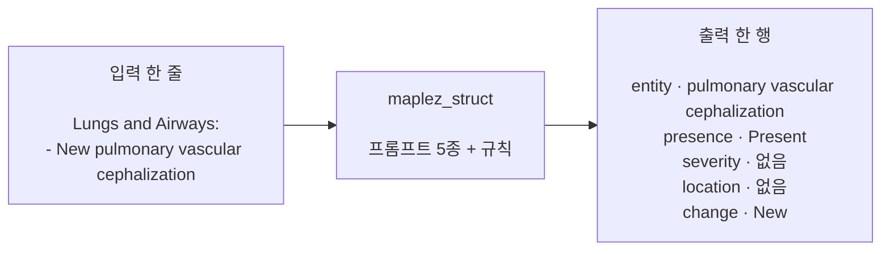
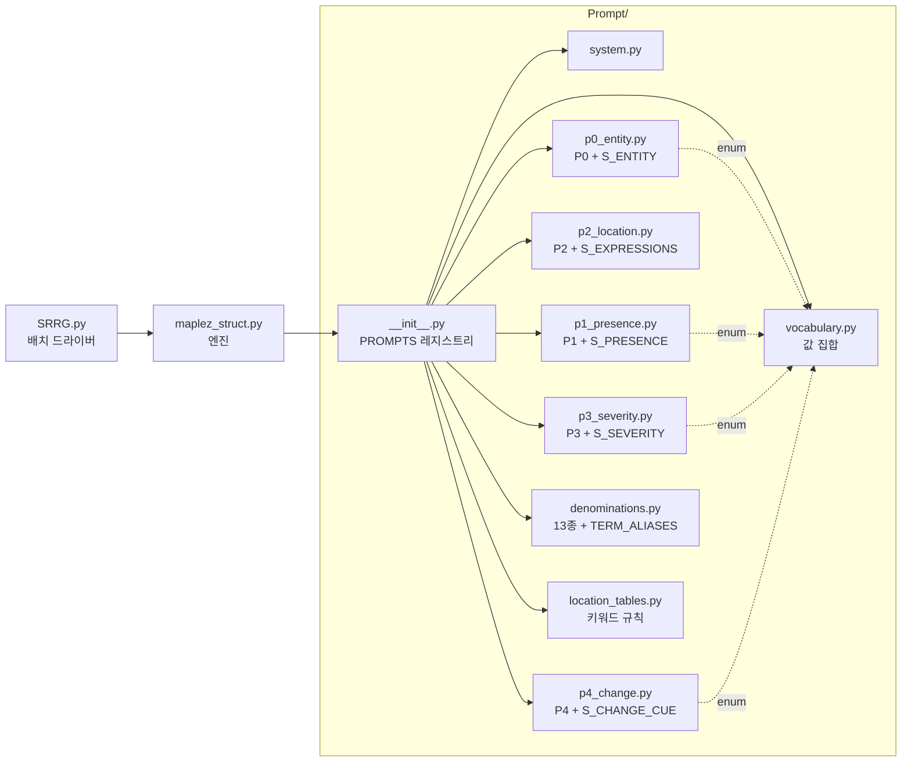
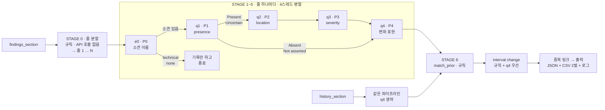
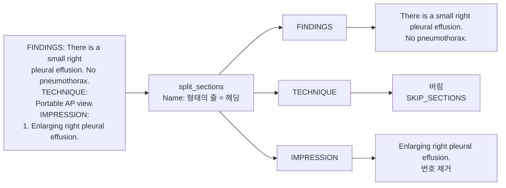
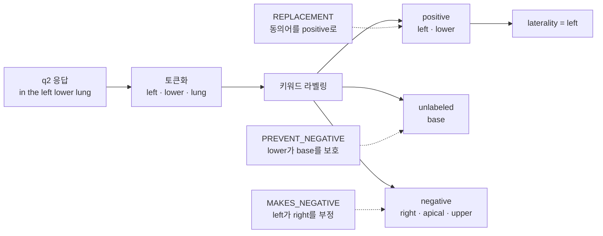
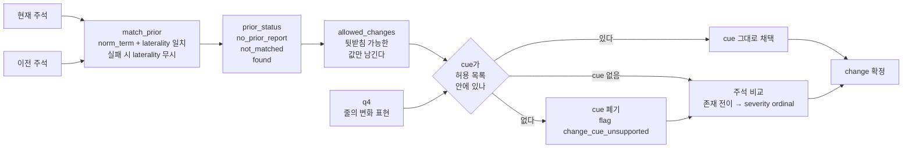
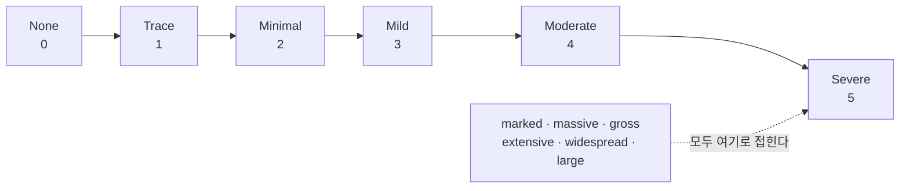
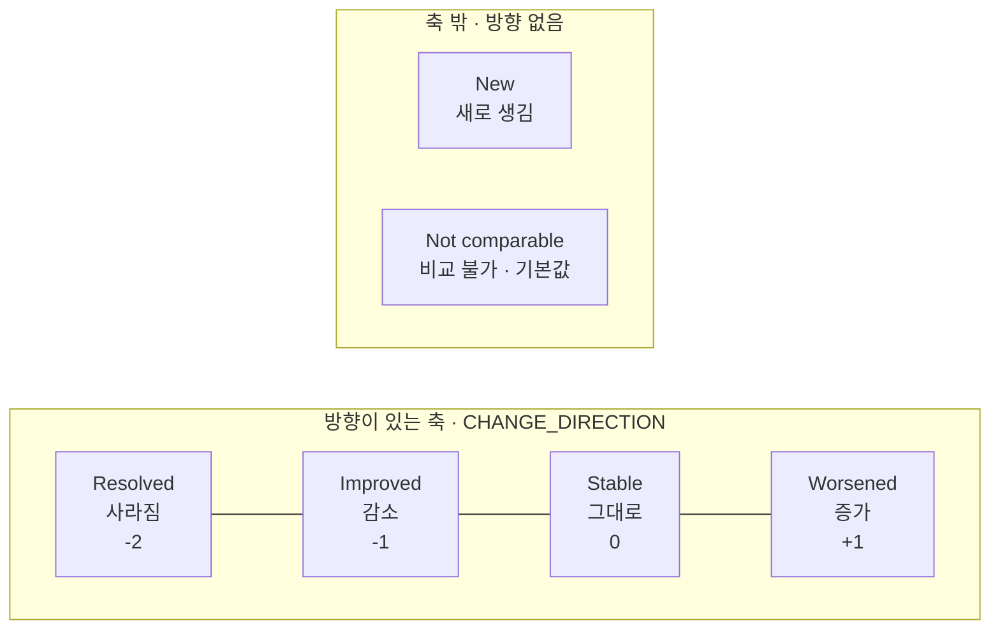
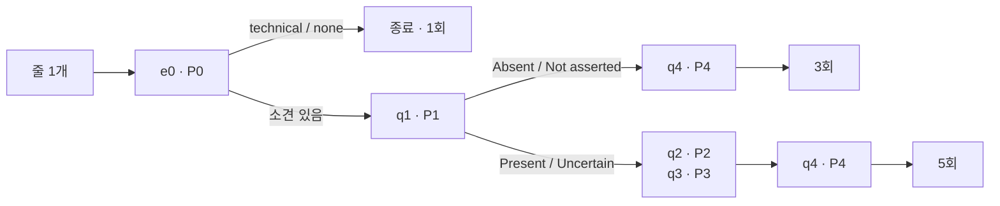

# ReportCXR — 흉부 X선 판독문 구조화

> **브랜치 `ReportCXR` — 1세대 (2026-08, 보관용).** 현재 개발본은 [`main`](https://github.com/DH82/ReportCXR/tree/main) 브랜치(ReportCXR-Ko)다.
> 이 브랜치는 MAPLEZ 논문식 *한 줄 = 소견 하나* 구조화기이며, 비교·재현용으로 남겨 둔다.
> 실행 산출물(`out_srrg_*`)과 API 로그는 판독문 원문을 담고 있어 저장소에 포함하지 않는다.

판독문의 **소견 한 줄**을 읽어, 그 줄이 말하는 **소견 하나**를 찾아내고 네 개의 축으로
구조화한다. OpenAI Chat Completions API + 강제 function calling으로 동작한다.



핵심 성질 네 가지:

| | |
|---|---|
| **1줄 = 1소견 = 1행** | 한 줄에서 소견을 하나만 뽑는다. 같은 줄의 다른 소견은 이름만 기록되고 주석되지 않는다 |
| **open vocabulary** | 고정 라벨 목록에서 고르지 않는다. `levoscoliosis`처럼 목록에 없는 소견도 그대로 잡힌다 |
| **축마다 호출 1회** | 소견 없는 줄 1회, 부재 소견 3회, 존재 소견 5회. 그 이상은 없다 |
| **모르면 null** | 줄에 없는 것은 추론하지 않는다. 모든 답은 tool 스키마가 강제하는 값 집합 안에 있다 |

근거 논문: Bigolin Lanfredi, Mukherjee, Summers (2024), *"Enhancing chest X-ray datasets
with privacy-preserving large language models and multi-type annotations"*,
Medical Image Analysis 99:103383. 프롬프트는 Appendix A.1.1의 결정트리를 축당 1회로
압축해 줄 스코프로 옮긴 것이고, 위치 키워드 규칙은 Appendix A.2.1–A.2.2를 그대로 쓴다.
**논문과 다른 점**: open-vocabulary entity 추출, 확률 축 미구현, severity 6단계,
interval change 축 추가.

---

## 1. 저장소 구성

```
ReportCXR/
│
├── maplez_struct.py          엔진: 설정 · 줄 분할 · API 클라이언트 · 규칙 · 오케스트레이션
├── SRRG.py                   드라이버: SRRG CSV를 불릿 하나씩 넣는 배치 실행기
│
├── Prompt/                   API로 나가는 모든 것 (단방향: 여기서 엔진을 import하지 않음)
│   ├── __init__.py             패키지 진입점 · PROMPTS 레지스트리
│   ├── system.py               SYSTEM_PROMPT      (모든 호출에 동봉)
│   ├── p0_entity.py            P0 + S_ENTITY      e0  이 줄의 소견 하나
│   ├── p1_presence.py          P1 + S_PRESENCE    q1  presence 4값 + cue
│   ├── p2_location.py          P2 + S_EXPRESSIONS q2  위치 표현
│   ├── p3_severity.py          P3 + S_SEVERITY    q3  None…Severe / Undefined
│   ├── p4_change.py            P4 + S_CHANGE_CUE  q4  변화 표현
│   ├── vocabulary.py           값 집합 (entity 종류 · presence · severity · change)
│   ├── denominations.py        Appendix A.1.2 13종 + TERM_ALIASES → 프롬프트의 {label}
│   └── location_tables.py      Appendix A.2.1–A.2.2 키워드 규칙 (API로 안 나감)
│
├── out_maplez/               단일 판독문 결과 + logs/
├── out_srrg_maplez/          배치 결과 + logs/
│
└── README.md                 ← 이 파일 (이 저장소의 유일한 문서)
```

**프롬프트 1개 = 파일 1개**이고, 그 프롬프트가 받아내야 하는 tool 스키마를 같은 파일에 둔다.
둘은 항상 같이 바뀌기 때문이다. 의존 방향은 **단방향**이다.



`Prompt/` 안의 어느 모듈도 `maplez_struct.py`를 import하지 않는다. 프롬프트 하나만 열어
읽고 고칠 수 있다는 뜻이다.

```python
from Prompt import SYSTEM_PROMPT, P0, S_ENTITY     # 권장
from Prompt.p1_presence import P1                  # 개별 모듈도 가능
```

---

## 2. 전체 파이프라인



각 호출은 **독립적**이다. 모델은 매번 그 줄 하나만 보고, 다른 줄도 이전 답변도 보지 못한다.
축 사이의 판정 누수(예: "increased"를 severity로 착각)를 프롬프트 문구로 차단한다.

---

## 3. 입력

두 가지 경로가 있다.

### 3.1 SRRG CSV (`SRRG.py`)

```
/data3/CXR/SRRG/srrg_findings_csv/validate.csv
  ├─ findings_section   SRRG findings 블록 (해부학적 헤딩 + "- " 불릿)
  ├─ history_section    임상 병력 한두 문장
  └─ id                 mimic-00000001
```

`findings_section`의 `- ` 불릿이 **나오는 순서대로 하나씩** 들어간다.

```
Lungs and Airways:                  →  #1  section = "Lungs and Airways"
- Linear opacity in the left            sentence = "Linear opacity in the left
  lower lung suggestive of                          lower lung suggestive of
  plate-like atelectasis.                           plate-like atelectasis."

Pleura:                             →  #2  section = "Pleura"
- No pleural effusion.                  sentence = "No pleural effusion."
```

`history_section`은 **prior 슬롯**에 들어가 행마다 한 번만 주석되고, 그 행의 모든 불릿이
공유한다. 임상 병력은 영상 소견이 아니므로 P0가 `none`을 내고, 결과적으로 비교 대상이
없어 change 축은 `Not comparable`이 된다 (줄 자체가 `new`라고 말하는 경우만 예외).

### 3.2 직접 입력 (`maplez_struct.py`)

파일 상단 `USER INPUT` 블록의 `CURRENT_REPORT` / `PRIOR_REPORT`에 텍스트를 넣는다.
`FINDINGS:` 같은 고전 헤더와 번호 매긴 IMPRESSION도 처리된다.

---

## 4. STAGE 0 — 줄 분할 (규칙, API 호출 없음)



규칙 네 가지:

| 규칙 | 예 |
|---|---|
| **`Name:` 형태의 줄이면 무엇이든 헤딩** | `Lungs and Airways:` · `FINDINGS:` 둘 다 인식. 47자 상한이 있어 콜론 든 평범한 문장은 헤딩이 되지 않는다 |
| `SKIP_SECTIONS`만 버린다 (블랙리스트) | TECHNIQUE · COMPARISON · HISTORY 계열 · INDICATION · EXAM |
| 불릿·열거 기호는 새 단위의 시작 | `- ` `* ` `1.` `2.` → 기호는 제거 |
| 하드 랩된 줄은 다시 잇는다 | `... tip is 4.5 cm` + `above the carina.` → 한 줄 (소수점 `4.5`는 공백이 없어 안전) |

> validate.csv 976행 전체에서 불릿 6015개를 하나도 놓치거나 더하지 않고 분해한다.

---

## 5. 프롬프트 5종

모든 호출은 `system` + `user` 두 메시지로 나가고, tool을 **강제 호출**시켜 산문 응답을
차단한다. 스키마를 벗어난 값은 API 단(tool 모드) 또는 로컬 검증(json 모드)에서 걸린다.

```python
client.chat.completions.create(
    model=MODEL,
    messages=[{"role": "system", "content": SYSTEM_PROMPT},
              {"role": "user",   "content": <아래 프롬프트>}],
    tools=[{"type": "function",
            "function": {"name": <tool 이름>, "parameters": <스키마>}}],
    tool_choice={"type": "function", "function": {"name": <tool 이름>}},
)
```

### 5.0  SYSTEM — 모든 호출에 동봉

**시스템적 역할**: 매 호출의 스코프를 못 박는다. ① 주어진 줄만 본다 ② 묻는 소견
하나만 판정한다 ③ 줄에 없는 것은 추론하지 않는다 ④ 반드시 tool을 호출한다.
이 네 가지가 "1줄 = 1소견", "모르면 null"을 지탱한다.

```text
A chat between a radiologist and an artificial intelligence assistant
trained to understand radiology reports and any synonyms and word
equivalency of findings and medical terms that may appear in the report. The
assistant gives helpful structured answers to the radiologist. The assistant
judges only the line it is given, and only the one finding it is asked
about. The assistant never infers anything the line does not state. The
assistant always answers by calling the provided tool and never answers in
prose.
```

---

### 5.1  e0 / P0 — 이 줄의 소견 하나

| | |
|---|---|
| 파일 | `Prompt/p0_entity.py` |
| placeholder | `{section}` `{sentence}` |
| tool | `name_entity` → `S_ENTITY` |
| 호출 시점 | 줄마다 **항상 첫 번째** |
| 논문 대응 | 없음 (이 스크립트 고유. 논문은 13종 고정 목록을 썼다) |

**시스템적 내용** — 이 프롬프트가 강제하는 다섯 규칙:

| 규칙 | 효과 | 예 |
|---|---|---|
| 1. entity 하나만 | 한 줄이 한 행을 낳는 근거. 나머지는 `other_candidates`에 이름만 | `A or B` → A만 주석 |
| 2. 수식어 전부 제거 | 이전 검사 매칭이 가능한 정규화된 term | `small right pleural effusion` → `pleural effusion` |
| 3. 부정문은 **부정당한 소견**의 이름 | 부재 판정을 presence 축에 넘긴다 | `the lungs are clear` → `lung opacity` |
| 4. `mention`은 원문 부분문자열 | 지어내면 `mention_not_in_sentence` flag | |
| 5. 증상·병력은 `none` | history_section이 여기서 걸러진다 | `shortness of breath` → `none` |

**전문**

```text
A chest X-ray report contains the following line under the heading
"{section}": "{sentence}". Name the one medical observation or finding that
this line is about. Follow these rules. (1) Return exactly one entity, the
one the line is primarily about. If the line names further findings, list
their names in "other_candidates" and describe none of them. (2) "term" is
the standard English name of the finding: lower case, singular, with every
modifier removed. Remove laterality, size, severity, negation and comparison
words. "small right pleural effusion" gives "pleural effusion"; "no evidence
of pneumothorax" gives "pneumothorax"; "New pulmonary vascular
cephalization" gives "pulmonary vascular cephalization". (3) When the line
denies a finding or calls a structure normal, name the finding that is being
denied, not the normality. "the lungs are clear" gives "lung opacity";
"normal mediastinal contours" gives "mediastinal abnormality". (4) "mention"
is copied verbatim from the line, as a substring. (5) entity_type:
"imaging_finding" for something seen on the image, "diagnosis" for an
interpretation of it (pneumonia, malignancy), "device" for lines, tubes and
hardware, "procedure" for surgical or interventional history (status post
lobectomy, CABG), "technical" for image quality statements (low lung
volumes, rotated, motion artifact), and "none" when the line describes no
imaging finding, device or procedure at all. A clinical symptom or piece of
history -- shortness of breath, fever, chest pain, a stated indication for
the exam -- is not an imaging finding and must be answered with "none" and
an empty term.
```

**스키마** `S_ENTITY`

```json
{
  "type": "object",
  "properties": {
    "term": {
      "type": "string"
    },
    "entity_type": {
      "type": "string",
      "enum": [
        "imaging_finding",
        "diagnosis",
        "device",
        "procedure",
        "technical",
        "none"
      ]
    },
    "mention": {
      "type": "string"
    },
    "other_candidates": {
      "type": "array",
      "items": {
        "type": "string"
      }
    }
  },
  "required": [
    "term",
    "entity_type",
    "mention",
    "other_candidates"
  ]
}
```

**예시**

```text
입력   section  = "Lungs and Airways"
       sentence = "New pulmonary vascular cephalization"

응답   {"term": "pulmonary vascular cephalization",
        "entity_type": "imaging_finding",
        "mention": "pulmonary vascular cephalization",
        "other_candidates": []}
```

`New`는 수식어이므로 term에서 빠진다(규칙 2). 이 term은 논문 13종에 없으므로
`known_label = None`, flag `open_vocabulary_term`이 붙고, 이후 `{label}`은 term을 그대로 쓴다.

---

### 5.2  q1 / P1 — presence

| | |
|---|---|
| 파일 | `Prompt/p1_presence.py` |
| placeholder | `{sentence}` `{label}` |
| tool | `answer_presence` → `S_PRESENCE` |
| 호출 시점 | e0가 소견을 찾았을 때 |
| 논문 대응 | Appendix A.1.1 프롬프트 1 + 8을 하나로 압축 |

**시스템적 내용**

- 4값을 **직접** 고르게 한다. 논문은 확률(%)을 받아 90 임계로 Present/Uncertain을
  갈랐지만, 이 구현에는 확률 축이 없다.
- 값마다 cue 목록을 프롬프트가 직접 제공한다 → 모델이 기준을 지어내지 않는다.
- 함정 세 가지를 명시한다:
  - `no definite` / `no significant` / `no gross` → **Absent**
  - 감별진단(`A versus B`, `A or B`) → 모든 후보 **Uncertain**
  - 부정어의 **적용 범위** 확인 → 해당 소견이 그 안에 있을 때만 Absent
- 판정 근거를 `cue`에 원문 그대로 적게 한다. 줄에 없으면 `cue_not_in_sentence` flag.

**전문**

```text
Given the line "{sentence}" from a chest X-ray report, decide what the line
states about "{label}" in this study. "Present": the radiologist asserts it
is there. Cue: "there is", "demonstrates", "consistent with", "compatible
with", or a plain noun phrase stated without hedging. "Uncertain": the
radiologist leaves it open. Cue: "possible", "probable", "likely",
"suspicious for", "may represent", "cannot be excluded", "questionable",
"concerning for", "versus". "Absent": the radiologist asserts it is not
there. Cue: "no", "without", "free of", "negative for", "clear",
"unremarkable", "normal". Read "no definite", "no significant" and "no
gross" as Absent. "Not asserted": the line names it but asserts nothing
about this study -- past history, a recommendation, a hypothetical. A
differential ("A versus B", "A or B") makes every candidate Uncertain. Check
the scope of a negation: answer Absent only when "{label}" falls inside it.
Copy into "cue" the word or phrase you judged from. Respond with exactly one
of: Present, Uncertain, Absent, Not asserted.
```

**스키마** `S_PRESENCE`

```json
{
  "type": "object",
  "properties": {
    "presence": {
      "type": "string",
      "enum": [
        "Present",
        "Uncertain",
        "Absent",
        "Not asserted"
      ]
    },
    "cue": {
      "type": "string"
    }
  },
  "required": [
    "presence",
    "cue"
  ]
}
```

**예시**

```text
입력   sentence = "New pulmonary vascular cephalization"
       label    = "pulmonary vascular cephalization"

응답   {"presence": "Present", "cue": "New pulmonary vascular cephalization"}
```

---

### 5.3  q2 / P2 — location

| | |
|---|---|
| 파일 | `Prompt/p2_location.py` |
| placeholder | `{sentence}` `{label}` |
| tool | `list_expressions` → `S_EXPRESSIONS` |
| 호출 시점 | presence가 **Present / Uncertain**일 때만 |
| 논문 대응 | Appendix A.1.1 프롬프트 9 + 10 + 11을 하나로 압축 |

**시스템적 내용**

- 논문은 ① 위치가 있는가 → ② 표현 추출 → ③ 표현마다 8개 범주 분류, 3단계였다.
  여기서는 **해부학적 위치만 남기라는 지시를 인라인**에 넣어 1회로 줄였다.
  게이트 질문은 빈 리스트가 대신한다.
- 제외 대상을 명시한다: severity · size · comparison · probability · texture,
  그리고 **다른 소견에 걸린 수식어**.
- 형용사 하나, 전치사구 하나마다 리스트 원소 하나로 쪼개게 한다 → 뒤의 키워드 규칙이
  토큰 단위로 처리할 수 있다.

**전문**

```text
Given the line "{sentence}" from a chest X-ray report, list the localizing
expressions characterizing specifically the "{label}" finding. Break the
answer down into each and every one of the localizing adjectives and each
independent localizing prepositional phrase, one per list element. Output an
empty list if there are 0 locations mentioned for "{label}". Do not mention
the central nouns identified as "{label}". Do not mention any nouns that are
not part of an adjective. Include only anatomical location: leave out
severity, size, comparison, probability and visual texture words, and leave
out expressions that belong to another finding. Use very short answers
without complete sentences.
```

**스키마** `S_EXPRESSIONS`

```json
{
  "type": "object",
  "properties": {
    "expressions": {
      "type": "array",
      "items": {
        "type": "string"
      }
    }
  },
  "required": [
    "expressions"
  ]
}
```

**예시**

```text
입력   sentence = "Linear opacity in the left lower lung suggestive of
                   plate-like atelectasis."
       label    = "atelectasis (collapse of the lung)"

응답   {"expressions": ["in the left lower lung"]}
       → "Linear", "plate-like"(texture), "suggestive of"(probability)는 제외
```

---

### 5.4  q3 / P3 — severity

| | |
|---|---|
| 파일 | `Prompt/p3_severity.py` |
| placeholder | `{sentence}` `{label}` |
| tool | `answer_severity` → `S_SEVERITY` |
| 호출 시점 | presence가 **Present / Uncertain**일 때만 |
| 논문 대응 | Appendix A.1.1 프롬프트 12 + 13을 하나로 압축 |

**시스템적 내용**

- 6단계 사다리를 **순서대로 나열**하고 각 단계의 동의어를 괄호로 붙인다.
- `Undefined`가 게이트 질문(프롬프트 12)을 대신한다 → "정도를 말하지 않았다".
- **비교·변화에서 정도를 유추하지 말라**고 못 박는다. `increased effusion`에서
  판정할 것은 effusion의 현재 정도이지 증가했다는 사실이 아니다.
- 범위 표현은 **상한**으로 접는다 (`mild to moderate` → Moderate).

**전문**

```text
Given the line "{sentence}" from a chest X-ray report, characterize the
severity of "{label}" only from the words of the line, and not from
comparisons or changes. The scale runs from least to most severe: "None" (a
degree is stated and it is zero), "Trace", "Minimal" (minimal, minor,
subtle, slight), "Mild" (mild, small), "Moderate", "Severe" (severe, large,
marked, massive, extensive). Answer "Undefined" when the line states no
degree at all. For a range such as "mild to moderate", answer with the upper
end. Do not add extra words to your answer and exclusively use one of those
seven options.
```

**스키마** `S_SEVERITY`

```json
{
  "type": "object",
  "properties": {
    "severity": {
      "type": "string",
      "enum": [
        "None",
        "Trace",
        "Minimal",
        "Mild",
        "Moderate",
        "Severe",
        "Undefined"
      ]
    }
  },
  "required": [
    "severity"
  ]
}
```

**예시**

```text
"Mild interstitial pulmonary edema"     →  {"severity": "Mild"}
"New pulmonary vascular cephalization"  →  {"severity": "Undefined"}
"Massive pleural effusion"              →  {"severity": "Severe"}
```

---

### 5.5  q4 / P4 — 변화 표현

| | |
|---|---|
| 파일 | `Prompt/p4_change.py` |
| placeholder | `{sentence}` `{label}` |
| tool | `answer_change` → `S_CHANGE_CUE` |
| 호출 시점 | **현재** 판독문의 줄에만 (이전 판독문은 생략) |
| 논문 대응 | 없음. 논문 프롬프트 2(stable/unchanged)가 2값으로 묻던 것을 6값으로 |

**시스템적 내용**

- 이 프롬프트는 **최종 판정을 내리지 않는다.** 줄에 실제로 쓰인 변화 표현만 보고한다.
  최종 change 값은 규칙 엔진이 이 답과 이전 주석을 합쳐 정한다(§6.3).
- 5개 값마다 신호 단어를 열거한다 → 모델이 표현을 해석하지 않고 사전을 참조한다.
- **severity에서 변화를 유추하지 말라**고 명시한다. 두 시점 비교는 규칙의 몫이다.
- 비교 진술이 없으면 `Not stated`. 이것이 기본값이다.

**전문**

```text
Given the line "{sentence}" from a chest X-ray report, decide what the line
itself states about how "{label}" has changed since a previous imaging
study. Use only wording present in the line; never infer a change from the
severity, and never guess. "new", "newly", "interval development", "not
previously seen", "not seen on the prior" indicate New. "resolved",
"resolution", "no longer seen", "cleared", "no longer present" indicate
Resolved. "decreased", "decreasing", "smaller", "less prominent",
"improving", "improved", "regressed", "partially resolved" indicate
Improved. "increased", "increasing", "larger", "enlarging", "more
prominent", "progression", "progressed", "worsening", "worsened" indicate
Worsened. "unchanged", "stable", "no interval change", "no significant
change", "persistent", "persists", "chronic", "similar to the prior"
indicate Stable. If the line makes no comparison with a previous study,
answer "Not stated". Respond with exactly one of: New, Resolved, Improved,
Worsened, Stable, Not stated.
```

**스키마** `S_CHANGE_CUE`

```json
{
  "type": "object",
  "properties": {
    "change": {
      "type": "string",
      "enum": [
        "Resolved",
        "Improved",
        "Stable",
        "Worsened",
        "New",
        "Not stated"
      ]
    }
  },
  "required": [
    "change"
  ]
}
```

**예시**

```text
"New pulmonary vascular cephalization"   →  {"change": "New"}
"Mild chronic cardiomegaly"    →  {"change": "Stable"}
"Right middle lobe atelectasis"          →  {"change": "Not stated"}
```

---

### 5.6  `{label}`은 무엇으로 채워지는가

P0가 낸 term이 논문 13종에 매핑되면(`TERM_ALIASES`) **denomination으로 확장**해서 묻고,
아니면 term 그대로 묻는다. 동의어 재현율을 올리는 논문의 장치다.

| P0의 term | known_label | q1~q4가 보는 `{label}` |
|---|---|---|
| `pulmonary vascular cephalization` | — | `pulmonary vascular cephalization` |
| `pulmonary edema` | Edema | `lung edema (congestive heart failure)` |
| `pneumothorax` | Pneumothorax | `pneumothorax (or pneumomediastinum or hydropneumothorax)` |
| `mediastinal abnormality` | Enlarged cardiomediastinum | `enlarged cardiomediastinum (enlarged heart silhouette or …)` |
| `surgical clip` | Support devices | `medical equipment or medical support devices (lines or tubes …)` |
| `levoscoliosis` | — | `levoscoliosis` |

매핑되지 않아도 **주석 대상에서 빠지지 않는다.** 자기 이름으로 질문받고 일반 흉부
키워드 집합을 쓸 뿐이다.

---
## 6. 규칙 단계 (API 호출 없음)

모델 답을 그대로 최종값으로 쓰지 않는다. 세 가지 규칙이 뒤따른다.

### 6.1 위치 키워드 라벨링 — Appendix A.2.1–A.2.2

q2가 낸 자유 표현을 토큰화해, 소견별 키워드 집합에 3값을 매긴다.



| 표 | 역할 |
|---|---|
| `REPLACEMENT` | 동의어·변형을 positive로 인정. `bibasilar`→`base`, `lingula`→`left`+`lower`, `bilateral`→`left`+`right` |
| `MAKES_NEGATIVE` | positive 키워드가 배타적으로 부정시키는 키워드. `right` positive → `left` negative |
| `PREVENT_NEGATIVE` | 위 부정에서 보호. `lower` positive면 `base`는 negative가 되지 않는다 |

positive는 항상 우선한다. 여기서 `left`/`right`를 읽어 `laterality`가 정해지고,
그것이 이전 검사 매칭 키의 일부가 된다.

### 6.2 severity 표 대조

입력이 짧은 한 줄이므로, `SEVERITY_WORDS` 표를 **줄 자체에** 적용해 모델 답과 대조한다
(presence가 존재 계열일 때만).

```
모델 답 있음 + 표도 값 찾음 + 불일치  →  모델 답 유지 + flag severity_table_mismatch
모델 답 없음 + 표가 값 찾음           →  표 값으로 채움 + flag severity_filled_from_table
```

**덮어쓰지 않는다.** 표는 감시자이지 판정자가 아니다.
`increasing`·`new` 같은 변화 표현은 조회 전에 제거되므로(`NO_SEVERITY_WORDS`)
`New pulmonary vascular cephalization`에서 `new`가 severity로 새지 않는다.

### 6.3 이전 검사 매칭 + interval change



**허용 목록 표** — `allowed_changes(presence, prior_status, prior_presence)`

| prior_status | 현재 presence | 이전 presence | 허용되는 값 |
|---|---|---|---|
| `no_prior_report` | — | — | New / Not comparable |
| `not_matched` | — | — | New / Not comparable |
| `found` | 부재 계열 | 존재 계열 | Resolved / Not comparable |
| `found` | 부재 계열 | 부재 계열 | Stable / Not comparable |
| `found` | 존재 계열 | 부재 계열 | New / Not comparable |
| `found` | 존재 계열 | 존재 계열 | Improved / Stable / Worsened / Not comparable |

> **이전 기록에 관련 내용이 없으면 `Not comparable`**이 원칙이다. 유일한 예외가
> `New`이고, 그것도 줄이 `new`/`newly`/`interval development`라고 **명시했을 때만**
> 통과한다. 허용 목록이 `["New", "Not comparable"]`이기 때문이다.

**주석 비교 (③)** — cue가 없거나 버려졌을 때

| 조건 | 결과 |
|---|---|
| 이전 존재 → 현재 부재 | `Resolved` |
| 이전 부재 → 현재 존재 | `New` |
| 양쪽 모두 부재 | `Stable` |
| 양쪽 severity 있음 | ordinal 증가 `Worsened` / 감소 `Improved` / 동일 `Stable` |
| 한쪽이라도 severity 없음 | `Not comparable` |

cue를 버리는 것이 손해가 아닌 이유: 줄은 "increased"인데 이전 판독문에서 그 소견이
`Absent`였다면, 맞는 답은 `Worsened`가 아니라 `New`다. 규칙이 그것을 낸다.

---

## 7. 축 값 집합

### presence

| 값 | 의미 | cue 예 |
|---|---|---|
| `Present` | 존재를 단정 | there is, demonstrates, consistent with, 수식 없는 명사구 |
| `Uncertain` | 존재가 불확실 | possible, likely, suspicious for, cannot be excluded, versus |
| `Absent` | 부재를 단정 | no, without, free of, negative for, clear, unremarkable, normal |
| `Not asserted` | 이번 검사에 대해 아무것도 단정하지 않음 | 병력, 권고, 가정법 |

존재 계열 = {Present, Uncertain}, 부재 계열 = {Absent, Not asserted}.

### severity — 0~5



정도를 말하지 않으면 `severity`·`severity_ordinal` 모두 null이다.
존재하는 소견에 `None`이 나오면 모순이므로 null로 되돌리고 flag를 남긴다.

### change — 6값



`Stable`은 Stable/Unchanged 단계다.

---

## 8. 호출 수



- 이전 판독문의 줄은 q4를 돌리지 않아 **1회씩 적다**.
- 4스레드 병렬(`MAX_WORKERS`). 한 줄 안의 호출은 순차다.
- `meta.api_calls` / `input_tokens` / `output_tokens`에 실제 사용량이 남는다.

예: 불릿 9개(존재 6 + 부재 3), 이전 판독문 없음 → **39회**.

---

## 9. 출력

```
out_maplez/  (단일)                out_srrg_maplez/  (배치)
├── annotations_<run>.json         ├── srrg_<run>.json         전체 필드
├── annotations_<run>.csv          ├── srrg_<run>.csv          25컬럼 (+ row_id, bullet_index)
├── annotations_<run>_slim.json    ├── srrg_<run>_slim.json    11필드 (+ row_id, bullet_index)
├── annotations_<run>_slim.csv     ├── srrg_<run>_slim.csv     11컬럼 (+ row_id, bullet_index)
└── logs/                          └── logs/
    ├── api_calls_<run>.jsonl        요청·응답 1건당 1줄 (성공·실패·재시도 전부)
    └── api_calls_<run>.log          system/prompt/response 전문, 사람이 읽는 형태
```

### 전체판과 slim판 — 두 벌씩, JSON과 CSV로

**전체 25컬럼** — 판정 + 근거 + 부기

`id, section, entity, entity_type, known_label, categorical, cue, severity,
severity_ordinal, laterality, location_positive, location_negative,
location_expressions, change, change_cue, change_reason, prior_status, prior_ref,
prior_categorical, prior_severity, other_candidates, duplicate_of, flags,
decision_path, sentence`

**slim 11컬럼** — 판정 + 원문 줄

`id, section, entity, entity_type, known_label, categorical, severity,
laterality, location_expressions, change, sentence`

slim 행은 전체 행에서 **위치로 잘라내므로**(`slim_row()`) 두 시트가 어긋날 수 없다.
**품질 게이트인 `flags`는 전체 시트에만 있다** — 검수는 전체 시트로.

**slim JSON** (`*_slim.json`)은 slim CSV와 **같은 레코드**를 담되, 납작한 배열 하나다.

```json
{
  "meta": { "run_id": "...", "model": "gpt-5.6-luna", "api_calls": 40, "..." : "..." },
  "annotations": [
    {
      "row_id": "mimic-00000002",        // SRRG.py가 낸 것에만
      "bullet_index": 1,                 // SRRG.py가 낸 것에만
      "id": "c1",
      "section": "Lungs and Airways",
      "entity": "pulmonary vascular cephalization",
      "entity_type": "imaging_finding",
      "known_label": null,
      "categorical": "Present",
      "severity": null,
      "laterality": null,
      "location_expressions": [],
      "change": "New",
      "sentence": "New pulmonary vascular cephalization"
    }
  ]
}
```

CSV와 다른 점 두 가지:

- **native 타입을 지킨다.** `location_expressions`가 `;`로 이어붙인 문자열이 아니라
  **리스트**이고, 빈 값은 `""`가 아니라 `null`이다.
- **행이 납작하다.** 전체 JSON은 `{"rows": [{"current": [...], "prior": [...]}]}`로
  중첩되지만, slim JSON은 `annotations` 배열 하나에 모든 행의 모든 불릿이 순서대로 들어간다.
  `pandas.read_json(...)["annotations"]`가 `read_csv`와 같은 모양이 된다.

`slim_record()`가 `slim_row()`의 JSON 쌍둥이이며, 둘 다 `SLIM_COLS`를 단일 기준으로 쓴다.

### decision_path

한 줄이 어떤 경로로 판정됐는지 그대로 남는다.

```
e0:imaging_finding:pulmonary vascular cephalization > q1:Present
   > q2:0 expression(s) > q3:Undefined > q4:New
```

### 주요 flags

| flag | 뜻 |
|---|---|
| `not_annotated:<type>` | technical/none이라 축 판정을 돌리지 않음 |
| `other_candidates:...` | 같은 줄이 언급했으나 주석하지 않은 다른 소견 |
| `open_vocabulary_term` | 논문 13종에 매핑되지 않은 용어 |
| `mention_not_in_sentence` / `cue_not_in_sentence` | 모델이 원문에 없는 문자열을 근거로 냄 |
| `severity_table_mismatch` / `severity_filled_from_table` | 표와 모델 판정의 불일치 / 결측 보완 |
| `severity_none_for_present_finding` | 존재하는 소견에 severity `None` |
| `change_cue_unsupported:<값>` | 줄의 변화 표현을 두 주석이 뒷받침하지 못해 폐기 |
| `match_relaxed:laterality` | 좌우를 무시하고 이전 소견을 매칭 |
| `also_stated_in:<id>` / `duplicate_of` | 같은 소견을 서술한 다른 줄이 있음 (합치지 않고 링크만) |
| `multi_sentence_bullet` | 한 불릿에 문장이 둘 이상 (SRRG.py) |

---
## 10. 워크스루 — 실제 실행 결과


> **공개용 처리** — 원 실행의 입력은 MIMIC-CXR 판독문이다. MIMIC 은 PhysioNet 자격 인증
> 데이터라 재배포할 수 없으므로, 공개 저장소에서는 행 id 를 `mimic-0000000N` 으로 가리고
> 일부 불릿 문장을 같은 소견의 다른 표현으로 바꿨다. 표·호출 수는 원 실행 기준이다.

아래는 **실제 API 실행 결과**다 (`gpt-5.6-luna`, run `20260826T014813Z-9e2ff0`).
입력은 CSV의 `mimic-00000002` 행.

```
findings_section                          history_section
─────────────────────────────────         ───────────────────────────────────
Lungs and Airways:                        The patient presents with acute shortness of breath.
- New pulmonary vascular cephalization
- Mild interstitial pulmonary edema
- Right middle lobe atelectasis

Pleura:
- No pneumothorax
- No large pleural effusion

Cardiovascular:
- Mild chronic cardiomegaly

Hila and Mediastinum:
- Normal mediastinal contours

Abdominal:
- Multiple surgical clips in the left upper abdomen

Musculoskeletal and Chest Wall:
- Scoliosis of the thoracolumbar spine
```

**STAGE 0** — 불릿 9개. 빈 줄은 버려지고, 헤딩은 자기 아래 불릿에 **각각** 붙는다
(`Lungs and Airways`가 #1·#2·#3에 따라간다). history는 1줄.

**결과** (slim CSV 그대로)

| # | section | entity | known_label | presence | sev | lat | location_expressions | change |
|---|---|---|---|---|---|---|---|---|
| 1 | Lungs and Airways | `pulmonary vascular cephalization` | — | Present | — | — | pulmonary | New |
| 2 | Lungs and Airways | `pulmonary edema` | Edema | Present | Mild | — | interstitial;pulmonary | Not comparable |
| 3 | Lungs and Airways | `atelectasis` | Atelectasis | Present | — | right | Right middle lobe | Not comparable |
| 4 | Pleura | `pneumothorax` | Pneumothorax | Absent | — | — | — | Not comparable |
| 5 | Pleura | `pleural effusion` | Pleural effusion | Absent | — | — | — | Not comparable |
| 6 | Cardiovascular | `cardiomegaly` | Cardiomegaly | Present | Mild | — | — | Not comparable |
| 7 | Hila and Mediastinum | `mediastinal abnormality` | Enlarged cardiomediastinum | Absent | — | — | — | Not comparable |
| 8 | Abdominal | `surgical clip` | Support devices | Present | — | left | left;upper;in the left upper abdomen | Not comparable |
| 9 | Musculoskeletal and Chest Wall | `scoliosis` | — | Present | — | — | thoracolumbar | Not comparable |

**호출 수** — `api_calls = 40`
(존재 6줄 × 5 + 부재 3줄 × 3 = 39, history 1줄 × 1 = 1).
토큰 in 18,484 / out 3,711.

**decision_path** — 줄마다 어떤 경로였는지

```
#1  e0:imaging_finding:pulmonary vascular cephalization > q1:Present > q2:1 expression(s) > q3:Undefined > q4:New
#4  e0:imaging_finding:pneumothorax > q1:Absent > q4:Not stated
#6  e0:imaging_finding:cardiomegaly > q1:Present > q2:0 expression(s) > q3:Mild > q4:Stable
#8  e0:device:surgical clip > q1:Present > q2:3 expression(s) > q3:Undefined > q4:Not stated
```

부재 판정(#4)은 q2·q3을 건너뛴 것이 경로에 그대로 보인다.

**읽는 법 다섯 가지**

- **#1 `New`** — 이전 판독문이 임상 문장뿐이라 P0가 `none`을 냈고, 비교 대상이 없어
  `prior_status = not_matched`가 됐다. 허용 목록은 `[New, Not comparable]`뿐이지만
  줄이 `New`라고 **명시**했으므로 통과했다. 비교 대상 없이 `New`가 나오는 유일한 경로.
  term에서 `New`가 빠졌고(P0 규칙 2), 13종에 없는 용어라 `open_vocabulary_term` flag.
- **#4·#5 `Absent`** — P0 규칙 3에 따라 **부정당한 소견**의 이름이 잡혔다
  (`pneumothorax`, `pleural effusion`). #5의 `large`는 수식어라 term에서 빠지고,
  부정문 안의 정도라 severity로도 새지 않았다.
- **#6 ⚠ `Not comparable`** — q4는 `chronic`을 읽고 `Stable`을 냈지만, 이전 기록이 없어
  허용 목록에 `Stable`이 없다. cue는 폐기되고 `change_cue_unsupported:Stable` flag가 붙었다.
  **없는 비교를 지어내지 않는다.**
- **#7** — `Normal mediastinal contours` → `mediastinal abnormality` + `Absent`.
  정상 서술을 "부정당한 소견의 부재"로 바꿔 다른 소견과 같은 축에 올린다.
- **#9** — 모델이 `Levoscoliosis`에서 방향 수식어를 떼고 `scoliosis`를 냈다(규칙 2).
  `levo-`는 `location_expressions`가 아니라 term에서 사라진 것이므로, 좌우 정보가
  필요하면 `sentence` 컬럼을 봐야 한다.

**q2의 잡음은 규칙이 흡수한다** — #1은 `pulmonary`를, #2는 `interstitial;pulmonary`를
위치 표현으로 냈다. 엄밀히는 해부학적 위치가 아니지만, 이들은 Appendix A.2.2 키워드
집합에 없어 positive가 되지 않고 `laterality`도 만들지 않는다. 반대로 #3의
`Right middle lobe`와 #8의 `left`는 정확히 `right`/`left`로 잡혔다.

---

## 11. 실행

```bash
pip install openai
export OPENAI_API_KEY="sk-..."
export OPENAI_MODEL="gpt-5.6-luna"          # 선택
export OPENAI_BASE_URL="https://.../v1"     # 선택 (게이트웨이 / vLLM 등)
```

| 명령 | 하는 일 | API 호출 |
|---|---|---|
| `python maplez_struct.py --selftest` | 규칙 테이블 전체 자체 검증 | **0** |
| `python maplez_struct.py --models` | 이 키로 실제 호출 가능한 모델 확인 | 몇 토큰 |
| `python maplez_struct.py` | 파일 상단 `CURRENT_REPORT` 주석 | 줄 수에 비례 |
| `python SRRG.py --dry-run` | 보낼 입력만 출력 | **0** |
| `python SRRG.py` | CSV 첫 행 | 불릿 수에 비례 |
| `python SRRG.py --id mimic-00000001` | id로 한 행 | |
| `python SRRG.py --rows 0-9 --yes` | 범위 | |
| `python SRRG.py --limit 50 --yes` | 앞에서 50행 | |
| `python SRRG.py --no-history` | history 미전송 (문장당 1회 절약) | |

20행을 넘으면 `--yes` 없이는 거부한다. 행마다 실제 과금이 발생하기 때문이다.

### 설정값 (`maplez_struct.py` 상단 CONFIG)

| 상수 | 기본값 | 의미 |
|---|---|---|
| `API_KEY` | `$OPENAI_API_KEY` | 비어 있으면 즉시 종료 |
| `BASE_URL` | `$OPENAI_BASE_URL` | 비우면 api.openai.com |
| `MODEL` | `$OPENAI_MODEL` 또는 `gpt-5.6-luna` | 모델/배포 ID |
| `MAX_TOKENS` | `None` | `None`이면 상한 파라미터를 **아예 보내지 않는다** |
| `RESPONSE_MODE` | `auto` | `auto` / `tool` / `json` (§14) |
| `MAX_WORKERS` | 4 | 줄 단위 병렬 스레드 수 |
| `MAX_RETRIES` | 3 | 실패 시 재시도 (1.5초 × 시도횟수 백오프) |
| `SKIP_SECTIONS` | TECHNIQUE, COMPARISON, HISTORY 계열 … | **버릴** 섹션 (블랙리스트) |
| `ANNOTATED_ENTITY_TYPES` | imaging_finding, diagnosis, device, procedure | 축 판정을 돌리는 종류 |
| `USE_GENERIC_DENOMINATIONS` | `False` | `True`면 denomination 확장 없이 term 그대로 질문 |

`SRRG.py` 상단에는 `CSV_PATH`, `FINDINGS_COL`, `HISTORY_COL`, `ID_COL`,
`CONFIRM_ABOVE`(=20)가 있다.

**규칙 테이블을 고쳤다면 `--selftest`부터 통과시킬 것.** ASCII 가드, 줄 분할, 용어 정규화,
위치 키워드 규칙(논문 예제), severity 사다리, 이전 매칭, interval change 6값, CSV 두 벌의
컬럼 정합성, json 모드 파싱, 로깅을 모두 검사한다.

---

## 12. 무엇을 고칠 때 어디를 보나

| 하고 싶은 것 | 고칠 곳 |
|---|---|
| 프롬프트 문구 수정 | `Prompt/p*.py` (해당 축 하나) |
| 답 값 추가/삭제 (예: severity 단계) | `Prompt/vocabulary.py` **와** 그 값을 제시하는 프롬프트 문구 |
| 새 용어를 논문 13종에 연결 | `Prompt/denominations.py`의 `TERM_ALIASES` 한 줄 |
| 위치 키워드 규칙 | `Prompt/location_tables.py` |
| CSV 컬럼 조정 | `maplez_struct.py`의 `CSV_COLS` / `SLIM_DROP` |
| 축 추가 | `Prompt/`에 모듈 + `__init__.py` 등록 + `maplez_struct.py`에 스테이지 1개 |
| 모델 · 병렬수 · 스킵 섹션 | `maplez_struct.py`의 CONFIG |
| CSV 경로 · 컬럼명 · 행 선택 | `SRRG.py`의 CONFIG |

`Prompt.PROMPTS`는 `stage id → (템플릿, 스키마, tool 이름)` 레지스트리다. 파이프라인이
실제로 호출하는 것과 어긋나면 `--selftest`가 잡는다.

---

## 13. 설계상 알아둘 것

1. **한 줄의 두 번째 소견은 사라진다.** 1줄 = 1소견이 설계다. 두 번째는
   `other_candidates`에 이름만 남는다. `No pneumothorax or pleural effusion`처럼
   부정어 하나가 여러 대상에 걸리는 줄을 전부 잡으려면 줄 분할 뒤에 절 분할 단계가 필요하다.
2. **임상 병력은 이전 영상 비교가 아니다.** `history_section`을 prior 슬롯에 넣어도
   change 축은 거의 항상 `Not comparable`이다. 맥락으로만 쓸 거라면 `--no-history`.
3. **term 자유도.** 동의어 사전(`TERM_ALIASES`)에 없는 표기가 나오면 이전 검사 매칭이
   실패해 `not_matched` → `Not comparable`이 된다.
4. **로그에 판독문 원문이 그대로 남는다.** 보관·공유 시 주의할 것.
5. **API로 나가는 모든 텍스트는 ASCII만 허용**된다. 한글이 섞이면 `assert_ascii()`가
   즉시 차단한다(프라이버시·재현성 목적). `sanitize_report()`가 비식별화 placeholder
   `___`를 `thing`으로 바꾸고 스마트 따옴표를 접는다.

---

## 14. 자주 만나는 문제

| 증상 | 원인 / 해결 |
|---|---|
| `API_KEY is empty` | `export OPENAI_API_KEY=...` |
| `ModuleNotFoundError: openai` | `pip install openai` |
| `403 ... does not have access to model` / `model_not_found` | 모델 ID 오타이거나 프로젝트에 권한 없음. `--models`로 실제 목록 확인 후 `OPENAI_MODEL` 지정 |
| `non-ASCII character(s) ... found in current report` | 판독문에 한글·특수문자가 남아 있음 |
| 줄이 이상하게 잘림 / 안 잘림 | `split_lines()`의 헤딩·불릿·문장 경계 정규식 확인. `--selftest`에 회귀 테스트가 있다 |
| 헤딩이 소견으로 잡힘 | `Name:` 형태가 아니거나 47자 초과 |
| 섹션이 통째로 무시됨 | 이름이 `SKIP_SECTIONS`에 있음(대문자 비교) |
| 소견 있는 줄인데 `not_annotated:none` | 로그의 `e0` 항목에서 실제 응답 확인. 증상·병력 문장이면 정상 |
| 한 줄의 두 번째 소견이 사라짐 | 설계상 정상. `other_candidates`에 이름만 남는다 |
| `no tool call returned` 반복 | 모델이 function calling을 지원하지 않음. `RESPONSE_MODE=json`으로 폴백하거나 모델 교체 |
| `RuntimeError: API call failed after 3 attempts` | 로그의 `error` 항목 확인. 레이트리밋이면 `MAX_WORKERS`를 낮출 것 |
| 응답이 잘림 | `MAX_TOKENS`가 설정돼 있으면 상향하거나 `None`으로. 추론형 모델은 reasoning 토큰이 이 한도를 함께 소모한다 |

**tool / json 모드**: 기본 `RESPONSE_MODE=auto`는 강제 tool call로 시작하고, 엔드포인트가
tool calling을 거부하면(400/404 + tools/function 언급) **그 실행 내내 json 모드로 전환**해
평문 응답에서 JSON을 추출·검증한다. 전환 시 stderr에 `[info] switching to json mode`.
HTTP 400/401/403/404는 재시도해도 소용없으므로 즉시 중단하고 `--models` 안내를 출력한다.
