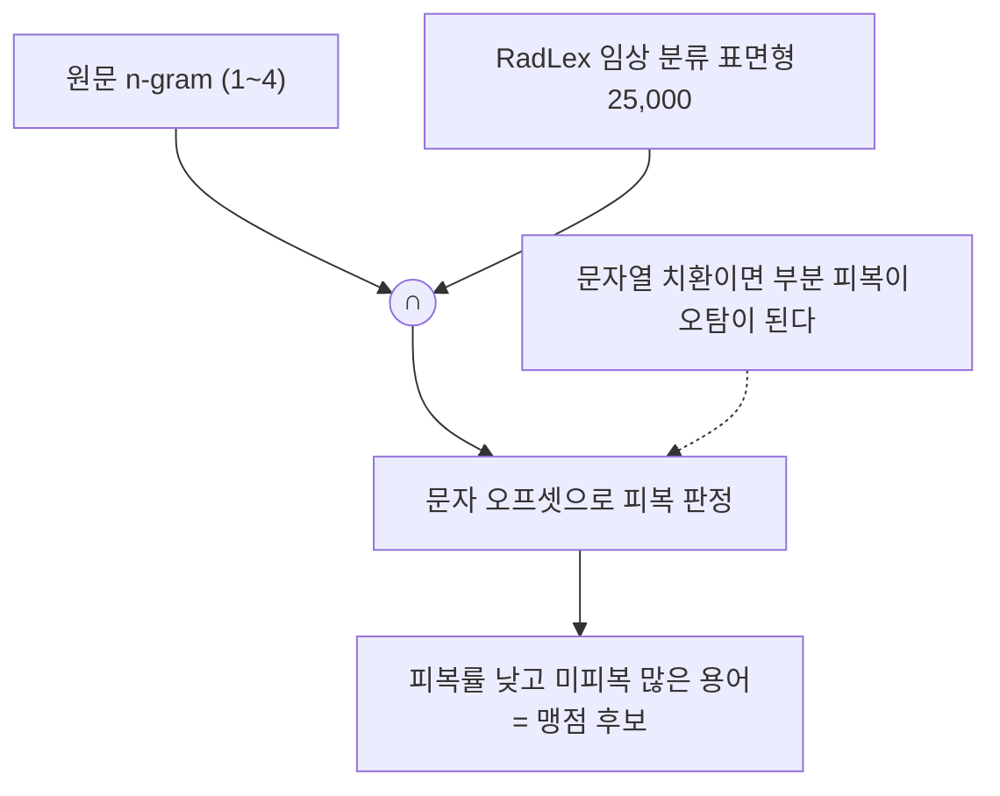

# RadLex — 국제 의학 용어사전과 맞춰 본 결과

> **한 줄 요약: 우리가 만든 용어가 국제 표준 용어사전(RadLex)에 있는 말인지
> 확인한 기록입니다.** 데이터는 건드리지 않습니다.
>
> **왜 했나요?** 우리 사전은 우리끼리 만든 것이라 "이게 맞나?"를 스스로는
> 증명할 수 없습니다. 그래서 **밖의 기준**에 대 봤습니다.
>
> **무엇을 알았나요?** 두 방향으로 봤습니다.
>
> | 방향 | 질문 | 결과 |
> |---|---|---|
> | **A** | 우리 용어가 RadLex에 있나? | 부위 90% · 소견 72% 일치 |
> | **B** | RadLex엔 있는데 우리가 한 번도 안 뽑은 개념이 있나? | **사실상 없음** (111만 문장에서 0건) |
>
> **가장 값진 발견**: RadLex도 **편측성(좌/우)을 개념 이름에 넣지 않습니다.**
> 우리는 넣고 있었습니다. 우리 내부 지표가 지적하던 문제를 **외부 권위가
> 독립적으로 같은 결론으로 확인해 준 것**이고, 그게 E1 결정의 근거가 됐습니다.

RadLex 4.3 (2025-12-01, RadLex License 2.0) 과 우리 라벨을 맞대 본 기록이다.
읽기 전용이고 데이터를 고치지 않는다.

도구: `Pipeline/radlex_import.py` (OWL → TSV), `radlex_match.py` (방향 A),
`radlex_blindspot.py` (방향 B)

> **⚠️ 아래 수치는 2026-09-04 측정이고, E1·E3 적용 이전의 표 기준이다**
> (지문 147·113·56). 현재 표는 107·130·75 이므로 라벨 수와 매칭 단계 분포가
> 다르다. 최신 수치는 `../out/reports/` 의 리포트와 `../Verify/README.md` 를 본다.
> 이 문서가 여전히 유효한 부분은 **RadLex 자체의 성질**이다 — 파싱 함정,
> 최상위 분류, RadLex 가 무엇을 모르는가.

---

## 0. 요약

| | 결과 |
|---|---|
| RadLex 파싱 | 46,898 개념 / 영문 라벨 45,987 / 동의어 17,651 / 정의 3,840 |
| **방향 A** — 우리 라벨이 RadLex 개념인가 | 등장 기준 **entity 71.7% · anatomy 90.0% · descriptor 78.6%** |
| **과잉 특정 라벨** | **2,968개** — RadLex 개념 위에 편측성·수식어를 덧씌운 것 |
| **방향 B** — 체계적 맹점 | 17,215 문장에서 **사실상 없음** (후보 3건, 그중 2건 오탐) |

가장 중요한 결과는 A의 부산물이다: **RadLex가 지표 1-B/1-C와 같은 결론을 독립적으로 낸다.**

---

## 1. 파싱 — punning 구조 함정

RadLex는 같은 RID를 `owl:Class` / `owl:NamedIndividual` / `rdf:Description` 셋으로 나눠 선언하고
주석을 그 사이에 흩어 놓는다. `owl:Class`만 읽으면:

```
영문 라벨   45,988 중 21,895 (48%)      동의어   17,651 중 7,114 (40%)
```

셋을 RID로 병합한 뒤 파일 실측치와 정확히 일치한다 (라벨 45,987 / 동의어 17,651 / 정의 3,840).

### 최상위 분류 (RID1 "RadLex entity"의 직계 자식)

| RID | 자손 | 이름 | 우리 필드 |
|---|---|---|---|
| RID3 | 38,178 | anatomical entity | **anatomy** |
| RID34785 | 2,240 | clinical finding | **entity** |
| RID35977 | 1,331 | property | descriptor |
| RID6 | 1,318 | RadLex descriptor | **descriptor** |
| RID5 | 1,214 | imaging observation | **entity** |
| RID1559 | 614 | procedure | 제외 |
| RID34861 | 405 | object | device |
| RID13158 | 22 | report component | 제외 |

**이 분류가 없으면 방향 B가 작동하지 않는다.** 필터 없이 돌리면 `frontal view`,
`assessment`, `not applicable`, `patient rotation` 같은 촬영·보고 분류어가 맹점 후보
상위를 채운다 (실제로 첫 실행에서 12건 중 12건이 그랬다).

---

## 2. 방향 A — 우리 라벨 ↔ RadLex

매칭은 단계적이고, **어느 단계에서 붙었는지가 매칭 여부보다 중요하다.**

### train 포함 전체 코퍼스

| 필드 | distinct | 등장 | 매칭 라벨 | **매칭 등장** |
|---|---|---|---|---|
| entity | 19,983 | 1,361,871 | 2,843 (14.2%) | **975,782 (71.7%)** |
| anatomy | 12,330 | 1,439,634 | 2,778 (22.5%) | **1,295,916 (90.0%)** |
| descriptor | 18,923 | 838,122 | 1,361 (7.2%) | **659,162 (78.6%)** |

라벨 기준 매칭률이 낮은 것은 꼬리가 hapax이기 때문이고, **등장 기준이 실질 지표다.**
예측대로 **anatomy에서 RadLex가 가장 강하고(90%), descriptor에서 가장 약하다.**

### 단계별 — 여기가 핵심

| 단계 | entity | anatomy | descriptor | 뜻 |
|---|---|---|---|---|
| exact | 926 | 755 | 559 | 그대로 일치 |
| plural | 195 | 127 | 16 | 복수형만 다름 |
| wordorder | 10 | 19 | 4 | `lung base` ↔ `base of lung` |
| **laterality** | **75** | **429** | **38** | ⚠️ 좌우를 벗겨야 일치 |
| **modifier** | **1,159** | **735** | **532** | ⚠️ 수식어를 벗겨야 일치 |
| surface | 478 | 713 | 212 | 라벨은 안 붙고 표면형만 |

> **매칭된 6,982개 라벨 중 2,968개(42%)가 편측성 또는 수식어를 벗겨야 붙는다.**

```
right_internal_jugular_vein  ->  internal jugular vein (RID1024) + laterality:right
focal_consolidation          ->  consolidation (RID43255)       + descriptor:focal
```

**RadLex는 편측성을 개념에 굽지 않는다.** 우리는 굽는다. 그 차이가 그대로
지표 1-B(anatomy 분열 토큰 71.6%)와 1-C(`chest_wall`이 305개 표면형 흡수)의 원인이다.

**즉 내부 일관성 지표와 외부 권위가 독립적으로 같은 결론에 도달했다** — 이것이
E1(편측성을 `laterality` 필드로 단일화)과 E2(기구 위치를 anatomy 로 분리)의
외부 근거다. **E1 과 E3 는 이후 적용되었다** (루트 `README.md` 참조).

### RadLex가 정말 모르는 것 — 미매칭 상위

**(a) silhouette / contour 계열 — 최대 공백, 약 98,000회**

```
entity   cardiomediastinal_silhouette 31,775 · cardiac_silhouette 17,218
         normal_cardiomediastinal_silhouette 10,490 · cardiomediastinal_contours 4,069
anatomy  cardiac_silhouette 15,978 · cardiomediastinal_silhouette 11,444
```

RadLex에는 `silhouette sign`(RID35544)뿐이다. 이것들은 **해부 개념이 아니라
판독문 언어 구성물**이다. `heart`(RID1385) + `normality` descriptor 조합으로 표현하는 것이
RadLex 정합적이다.

**(b) `normal_*` / `unremarkable_*` 계열** — `anatomical_state`가 RadLex에 대응이 없다는
예측이 확인됐다. 결정 E3(`normal_heart_size` → `heart_size` + `normality:normal`)의
근거이고, **E3 적용 후 이 계열은 라벨에서 사라졌다** (P1c 8.0% → 0.0%).

**(c) 모호한 뭉뚱그림** — `osseous_abnormalities` 13,348 · `degenerative_changes` 10,549 ·
`bony_structures` 5,516 · `osseous_structures` 4,660 · `bony_abnormalities` 4,097

**(d) RadLex에 없는 실제 CXR 구획** — `retrocardiac_region` 18,094 ·
`right_subdiaphragmatic_region` 6,308 · `mid_lung` 4,364 · `above_carina` 2,496 ·
`below_diaphragm` 2,323. 진짜 판독 구획이므로 **근거를 적어 로컬 확장**할 대상.

**(e) 기구 위치가 descriptor·anatomy로 샌 것** — `tip_in_mid_svc` 3,631 ·
`tip_at_cavoatrial_junction` 2,594 · `mid_svc` 3,914 · `distal_svc` 1,022 ·
`cavoatrial_junction` 3,976. RadLex는 `superior vena cava`(RID1010)만 갖는다.
SVC 구간은 해부가 아니라 **카테터 끝 위치**다.

**(f) 단수/복수 중복 라벨 — 공짜로 얻은 정리 대상**

```
upper_limit_of_normal 3,595  /  upper_limits_of_normal 2,209
bony_structures       5,516  /  osseous_structures     4,660
bony_abnormalities    4,097  /  osseous_abnormalities 13,348
low_svc                      /  lower_svc
```

**(g) `cardiomegaly`는 RadLex에 없다.** `cardiac enlargement`, `enlarged heart`도 없다.
RadLex의 소견 어휘는 생각보다 얇다 — entity는 **SRR-BERT 55 / CheXpert 14로 보완**해야 한다.

---

## 3. 방향 B — 체계적 맹점

### 방법



### 결과 (validate + test + test_reviewed, 17,215 문장)

```
맹점 후보 3개 / 미피복 86건
  patient      RID49815   피복률 0.21   <- 오탐 (사람은 소견이 아님)
  assessment   RID36026   피복률 0.36   <- 오탐
  tips         RID1595    피복률 0.33   <- 경계 사례
                "lead tips located in the right atrium" -> tip_location 이어야 할 수도
```

> **체계적 임상 맹점이 사실상 없다.** 모델이 개념 범주를 통째로 빠뜨리지는 않는다.

### train 전량 확인 (1,114,559 문장, 등장>=30)

```
맹점 후보 2개 / 미피복 3,427건
  patient      RID49815   피복 1,302 / 미피복 2,038   0.39   <- 오탐
  assessment   RID36026   피복   373 / 미피복 1,389   0.21   <- 오탐
```

65배 규모에서도 **임상 개념 맹점은 0건**이다. 남은 둘은 RadLex가 `object`/`clinical
finding` 아래 두었지만 판독문에서는 소견이 아닌 낱말이다 (`"limited due to
obscuration by the patient's chin"`, `"the study is not specifically tailored"`).

> **결론: 프롬프트에 체계적 임상 맹점이 없다.** 모델이 개념 범주를 통째로
> 빠뜨리지는 않는다. 111만 문장 규모의 음성 결과이므로 신뢰할 만하다.

한계는 명확히 해 둔다:
- 등장 30회 미만 용어는 임계 아래라 안 보인다
- 피복률 0.5 초과(절반 넘게 추출됨)는 안 보인다 — 그건 코퍼스 자기 일관성 검사의 몫
- RadLex에 없는 개념(§2 (a)(g): silhouette 계열, cardiomegaly)은 원리상 못 잡는다.
  **SRR-BERT 55 / CheXpert 14 대조가 이 구멍을 메운다**

**역할 분담이 확인됐다**: 코퍼스 자기 일관성은 "들쭉날쭉한 누락", RadLex는 "체계적 맹점".
후자가 비어 있다는 것은 전자에 집중하면 된다는 뜻이다.

---

## 4. 이후 진행

| | 작업 | 상태 |
|---|---|---|
| 1 | 결정 E1(편측성) · E3(정상성) | **적용됨.** 표는 `Prompt2/ontology.py` |
| 2 | 결정 E2(기구 위치 · 혈관 구간) | 어휘에 선언만 있고 `normalize.py` 에 구현이 없다 |
| 3 | 단수복수 중복 라벨 병합 | 일부 반영. 나머지는 `Verify` P2 목록에 있다 |
| 4 | RadLex 에 없는 개념의 로컬 정의 | `Prompt2/relations.py` — 현재 개념 24 · 관계 22 |
| 5 | silhouette / contour 계열 처리 방침 | **미정.** 98,000회, 최대 단일 공백 |
| 6 | 코퍼스 자기 일관성 누락 검사 | `Verify` P3 으로 구현됨. 방향 B 가 비었으므로 여기가 주전장 |

## 재현

```bash
# OWL -> TSV (RadLex/radlex_terms.tsv 생성)
python3 Pipeline/radlex_import.py --owl RadLex/RadLex.owl

# 방향 A — 우리 라벨이 RadLex 개념인가
python3 Pipeline/radlex_match.py --split test

# 방향 B — 체계적 맹점
python3 Pipeline/radlex_blindspot.py --split test --split validate
```

`RadLex/*.owl`(83MB)은 추적하지 않는다. RSNA 에서 받는다. 파생
`radlex_terms.tsv`(4MB)는 재현에 필요하고 작아서 추적한다.
