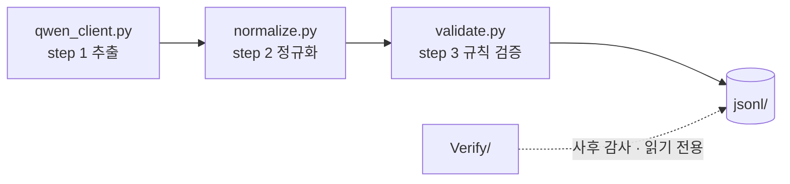
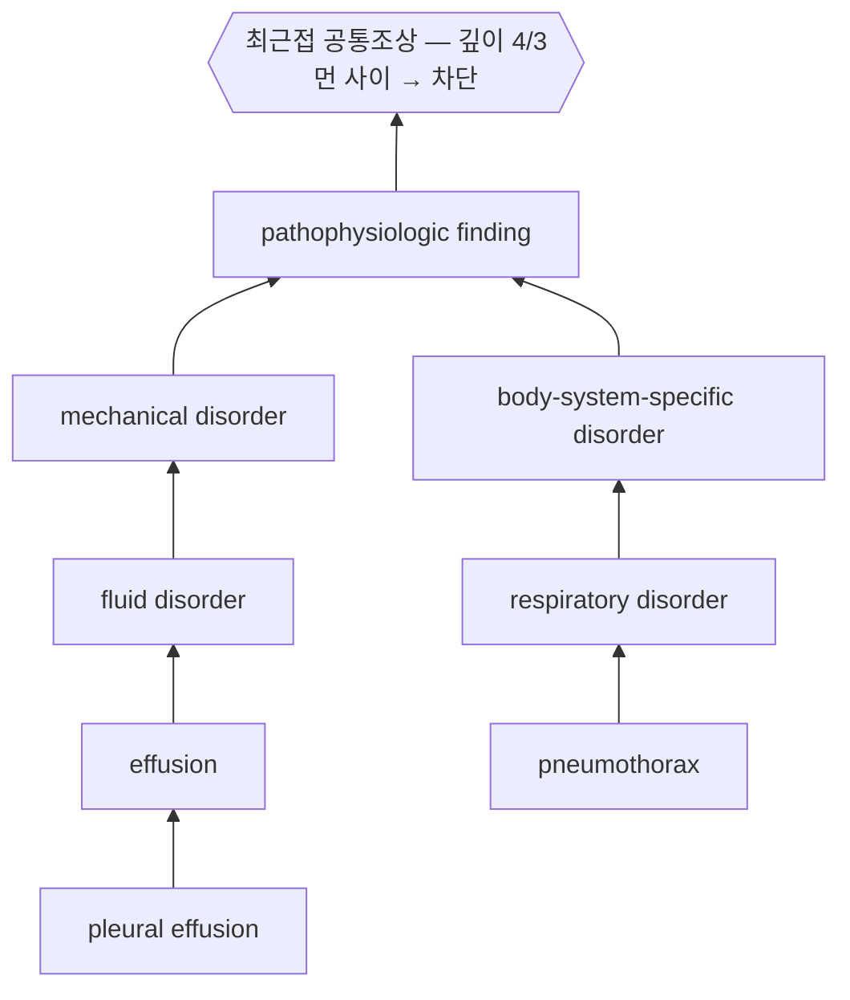
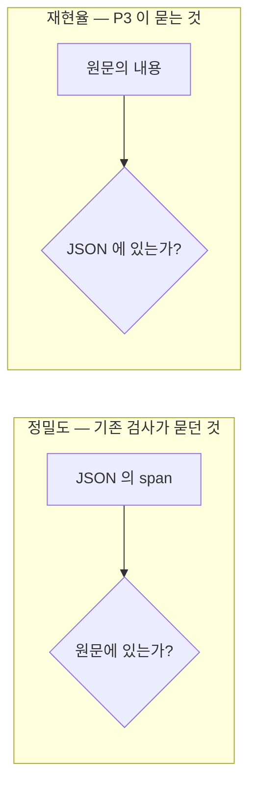

# Verify — 채점 도구

> **한 줄 요약: 만들어 놓은 데이터가 잘 됐는지 17가지 관점으로 채점하고,
> 주제별 md 6장과 `INDEX.md` 한 장을 냅니다.**
> **데이터를 절대 고치지 않고 읽기만** 합니다 — 만든 코드가 채점까지 하면
> 자기 실수를 못 보기 때문입니다.
>
> 채점은 여섯 묶음으로 나뉘고, 묶음 하나가 md 한 장입니다.
>
> | 묶음 (= md 한 장) | 묻는 것 | 요소 |
> |---|---|---|
> | `g1_integrity` | 파일이 멀쩡한가, 문장을 잃지 않았나 | S · C · 0 |
> | `g2_vocabulary` | 온톨로지가 표면형을 제대로 접었나 | 1-A · 1-B · 1-C · 1-D · P2 |
> | `g3_fields` | 라벨과 그 옆 칸이 서로 맞나 | 1-E · 1-F |
> | `g4_rules` | 명세 규칙을 어겼나 | R |
> | `g5_grounding` | **JSON 이 원문을 실제로 읽었나** | G1 · G2 · P3 |
> | `g6_overspec` | 라벨이 필드의 일을 대신하나 | P1a · P1b · P1c |
>
> 기호가 헷갈리면 [`../Glossary.md`](../Glossary.md) 를 보세요.

`jsonl/`의 구조화가 제대로 되었는지를 **평가요소 17개**로 나누어 판정한다.
읽기 전용이다. `jsonl/`을 수정하지 않고, 모델을 호출하지 않고, 레코드를 변형하지 않는다.

**측정하는 단위와 읽는 단위는 다르다.** 2026-09-15 재구성의 규칙이고, 이걸
뒤섞어서 이 리포트는 **양방향으로 한 번씩 실패했다.**

합본 하나였을 때는 전부가 숨었다. 보고 싶은 하나에 닿으려면 관심 없는 열한 개를
스크롤해야 했고, `git diff` 는 "리포트가 바뀌었다" 이상을 말하지 못했다.
그래서 쪼갰더니 **md 가 18장이 되었고, 18장은 읽는 결과가 아니라 뒤지는
디렉터리다.**

그래서 쪼갬은 값을 하는 자리에 남기고, 합침은 한 단계 위에서 한다.

| 단위 | 뜻 | 왜 |
|---|---|---|
| **요소** (metric) | 측정의 단위. `metrics/mNN_*.py` 하나 | **판정이 정확히 하나여야 한다.** 서로 다르게 답하는 두 질문(1-B 는 WARN, 1-C 는 INFO)을 한 판정으로 덮으면 둘 중 어느 것도 아니게 된다 |
| **묶음** (group) | 읽기의 단위. md 파일 하나 | 한 주제 = 한 파일. **묶음의 판정은 속한 요소 중 가장 무거운 것**이고 평균이 아니다 — 평균이면 FAIL 하나가 PASS 넷 뒤에 숨는다 |

**묶는 기준은 숫자의 모양이 아니라 "고칠 자리가 어디인가" 다.** 어휘 묶음은
전부 `Prompt2/ontology.py` 의 표를 고쳐서 해결되고, 근거 묶음은 **어떤 표로도
해결되지 않는다** — 읽지 않은 문장을 인용하게 만드는 표는 없으므로 고칠 자리가
프롬프트다. 둘 다 WARN 이라도 보내는 곳이 다르면 한 묶음이 아니다.



---

## 0-A. 이 검사들이 얼마나 맞는가 — 2026-09-15 측정

**이 절은 2026-09-15 에 처음 생겼다.** 그전까지 17개 지표는 각각 얼마나
맞는지 아무도 모르는 채로 쓰이고 있었고, 재보니 **전부 오탐인 검사가 둘**
있었다. 지표를 늘리기 전에 이 표를 채우는 것이 먼저다.

측정 방법: `jsonl/Prompt/test_reviewed.jsonl` 에서 코드별로 최대 30건씩
무작위 추출(`GPT/goldset.py sample --mode precheck`), **별도 모델 패스가**
건별로 맞음/오탐 판정. 총 192건. **사람이 낸 정답이 아니라 2차 모델 판정과의
일치도다** — 두 모델이 같은 맹점을 공유하면 실제보다 높게 나올 수 있다.
최종 확정 전에는 사람 검수가 한 번 더 필요하다.

| 검사 | 정밀도 | 표본 | 그래서 |
|---|---|---|---|
| `entity_text_not_in_utterance` | **1.00** | 7/7 | 집계해도 됨 |
| `anatomy_source_carries_span` | **1.00** | 30/30 | 〃 |
| `anatomy_span_is_side_only` | **1.00** | 24/24 | 〃 |
| `laterality_contradicts_label` | **1.00** | 2/2 | 표본 부족 |
| `normal_state_as_absence` | **1.00** | 2/2 | 표본 부족 |
| `device_tip_not_located` | 0.80 | 8/10 | 사람이 최종 걸러야 함 |
| `no_propositions` | 0.77 | 10/13 | 〃 |
| `should_be_one_proposition` | 0.50 | 1/2 | 표본 부족 |
| `anatomy_span_is_relative` | 0.20 → **1.00** | 1/5 → 1/1 | 조건을 좁힘 |
| **`section_conflict`** | **0.00** | 0/16 | **info 로 강등** |
| **`chronicity_as_comparison`** | **0.00** | 0/17 | **폐기** |

### 0.00 이었던 둘

**`section_conflict`** — 메시지가 스스로 `the utterance stands` 라고
인정한다. 상류 SRRG 의 섹션 배정과 발화가 어긋난다는 **관찰**이지 구조화가
틀렸다는 판정이 아니다. 지우지 않고 `severity: info` 로 낮춰 결함 집계에서만
뺐다 — 상류 품질 지표로는 값이 있다.

**`chronicity_as_comparison`** — `persistent` 를 만성도로 보내려던 검사.
17/17 이 오탐이었다. 흉부 영상에서 `persistent` 는 이전 검사 대비 지속을
뜻하는 **변화 서술자**이므로 `comparison=stable` 이 맞다. 진짜 결함은 반대
방향, 즉 **같은 단어가 comparison 과 chronicity 서술자 양쪽에 있는 것**
(17건)이었고, 검사를 그 방향으로 교체했다
(`chronicity_comparison_duplicated`).

> **이 둘에서 배울 것:** 검사가 오래 돌았다는 사실은 그 검사가 맞다는
> 증거가 아니다. `chronicity_as_comparison` 은 스펙 문구와도 일치했고
> 코드도 정확히 그 문구대로 동작했다. 틀린 것은 **문구 자체**였고, 그것은
> **별도 모델 패스가 같은 행을 다시 판정해서야** 드러났다 — 사람이 도메인
> 지식으로 잡은 것이 아니다. 모델 대 모델 교차검증도 값을 하지만, 이
> 판정은 아직 사람이 최종 확인한 적이 없다는 뜻이기도 하다.

### 남은 일

`GPT/goldset.py --mode full` 로 **재현율**을 재야 한다. 위 표는 "잡은 것이
맞는가"만 말하고 "놓친 것이 없는가"는 말하지 않는다.

---

## 1. 빠른 시작

저장소 전체의 목적별 실행 안내는 [`../Start.md`](../Start.md) 에 있고,
섹션 기호(S · C · 0 · 1-A · R · P1 …)의 뜻은 [`../Glossary.md`](../Glossary.md)
에 전부 모아 두었다 -- **A/B 의 S1~S8 층이나 Phase 0 의 C1~C3 관문과는
다른 기호다.**

```bash
cd Verify

python3 run.py --list                 # 묶음과 요소 목록
python3 run.py                        # train 제외 (약 1분)
python3 run.py --all                  # train 포함, 4개 split 전부 (수십 분)
python3 run.py --all --examples-from test   # 예시를 다른 split 에서
python3 run.py --all --examples-from all    # 전 split 예시 (길어진다)
python3 run.py --split test_reviewed  # 한 split 만
python3 run.py -g g5                  # 묶음 골라서 (키 앞부분만 써도 된다)
python3 run.py -s S -s C -s 0         # 요소 골라서
python3 run.py -s R --limit 3000      # 레코드 상한
python3 run.py --one ../out/reports/report.md   # 예전처럼 한 파일로도

python3 metrics/m10_rules.py          # 요소 단독 실행도 된다
python3 tools/lexicon.py --all        # 단어장 생성 → ../out/lexicon/lexicon.tsv
```

**출력은 `../out/reports/<arm>/<splits>/` 로 간다.** 묶음마다 `gN_*.md`
하나(전부 6장), 그리고 `INDEX.md` 한 장이다.

### 숫자는 전 split, 예시는 한 split

각 요소의 §2 는 **`**Per split**` 표로 시작한다.** 네 split 을 나란히 놓는 이유는
이 감사의 질문이 절대값이기 전에 **비교값**이기 때문이다 — test 의 25% 는
train 이 24% 일 때와 3% 일 때 전혀 다른 뜻이다. 한 split 만 튀면 데이터 문제이거나
표본 문제인데, 어느 쪽이든 split 별로 흩어진 절들을 스크롤해서는 보이지 않는다.

**예시 행은 `test_reviewed` 에서만 나온다** (`--examples-from` 으로 변경).
같은 결함은 어느 split 에서나 같은 모양이므로 네 벌의 예시는 읽을거리만 네 배가
되고 새로 알려 주는 것이 없다. `test_reviewed` 인 이유는 **사람이 실제로 손으로
들여다보는 split** 이기 때문이다.

> **두 요소는 split 별 표를 갖지 않고, 그건 빠진 것이 아니다.**
> **1-D** 의 판정 단위는 split 이 아니라 **어휘 전체**다 — 두 라벨이 같은
> 개념인지는 그 둘이 어느 split 에 나왔는지와 무관하고, split 마다 따로 세면
> 한쪽에만 나온 쌍이 사라진다.
> **P3** 은 손으로 선언한 사전 없이 **코퍼스를 자기 자신의 사전으로** 쓴다.
> split 하나만 보면 그 안에서 드문 용어가 전부 누락 후보로 올라온다.
> 두 파일 모두 그 이유를 본문 첫 줄에 적고 시작한다.

**P2 의 split 별 표는 행끼리 직접 비교하면 안 된다.** 라벨이 한 split 에서
`--min-freq` 회 이상 나와야 후보가 되므로, 같은 결함률이라도 작은 split 이
적게 보고한다. 그 split 크기에 대한 비율로 읽을 것.

### `INDEX.md` — 먼저 볼 것

두 층으로 된 표다. **굵은 줄이 묶음이고 곧 파일 하나**이며, 그 아래 들여쓴
줄들이 그 묶음에 속한 요소다. 묻는 질문이 다르기 때문에 층이 둘이다 —
*어느 주제가 문제인가*와 *그 안의 어느 요소인가*.

**묶음의 판정은 속한 요소 중 가장 무거운 것이다. 평균이 아니다.** 평균을 내면
FAIL 하나가 PASS 넷 뒤에 숨는데, 요약이 절대 해서는 안 되는 일이 그것이다.

여섯 가지 판정이 있고, **그중 둘은 초보자가 반드시 헷갈린다.**

| 판정 | 뜻 |
|---|---|
| `PASS` | 고칠 것 없음 |
| `WARN` | 진짜 신호이지만 막는 결함은 아님 |
| `FAIL` | **이걸 고치기 전에는 나머지 숫자가 의미 없음** |
| `INFO` | 사람에게 넘기는 목록. 점수가 아님 |
| `BLIND` | **측정이 안 된 것.** 볼 수 있는 어휘가 너무 적어 판정 불가 |
| `SKIP` | 전제가 없어 못 돌림 |

> **`BLIND` 는 `PASS` 가 아니다.** 1-E 는 렉시콘이 아는 단어끼리만 축 충돌을
> 셀 수 있으므로, 아무것도 모르는 렉시콘은 충돌 0 을 보고한다. 그 0 은
> 데이터가 깨끗하다는 뜻이 아니라 **측정이 일어나지 않았다**는 뜻이다.
> 그래서 커버리지가 바닥이면 `PASS` 대신 `BLIND` 로 찍는다.
>
> **`INFO` 도 `PASS` 가 아니다.** 1-C · 1-D · P3 은 임상 판단 없이는 옳고
> 그름을 말할 수 없는 목록을 낸다. 그 행 수를 결함 수로 세면 이 감사기의
> 온톨로지 해석을 데이터의 성질로 보고하게 된다.

### 디렉터리

```
Verify/
  run.py                 통합 실행. metrics/ 를 번호순으로 자동 발견
  core.py                공용 — 로딩, 온톨로지 접근, 분류 판정, 판정 타입, 표 출력
  metrics/
    groups.py            어느 요소를 함께 읽는가 — 묶음 정의. md 파일 수를 정한다
    __init__.py
    ── g1_integrity ────────────────────────────────────
    m01_structure.py         S    파일 구조
    m02_completeness.py      C    소스 왕복 완전성
    m03_fixed_point.py       0    고정점
    ── g2_vocabulary ───────────────────────────────────
    m04_coverage.py          1-A  온톨로지 커버리지
    m05_under_norm.py        1-B  과소 정규화
    m06_over_norm.py         1-C  과대 정규화 후보
    m07_merge.py             1-D  병합 후보 (RadLex 계층)
    m17_duplicates.py        P2   같은 개념, 갈린 라벨
    ── g3_fields ───────────────────────────────────────
    m08_axis_purity.py       1-E  descriptor 축 순도
    m09_invariants.py        1-F  사후 불변식
    ── g4_rules ────────────────────────────────────────
    m10_rules.py             R    규칙 검증 (step 3)
    ── g5_grounding ────────────────────────────────────
    m11_span_grounding.py    G1   span 근거성        ← 2026-09-15 신규
    m12_cue_agreement.py     G2   cue-라벨 정합       ← 2026-09-15 신규
    m18_recall.py            P3   재현율 (누락)
    ── g6_overspec ─────────────────────────────────────
    m14_overspec_side.py     P1a  편측성이 라벨에
    m15_overspec_tip.py      P1b  기구 위치가 문자열에
    m16_overspec_normality.py P1c 정상성이 라벨에
    ── 공용 측정 (요소가 아님) ──────────────────────────
    _mapping.py              1-B·1-C 공용
    _overspec.py             P1a·P1b·P1c 공용
  tools/                 리포트에 들어가지 않는 도구
    lexicon.py           단어장 빌더 (RadLex + 코퍼스)
    diff_probe.py        고정점 상세 진단
    sample_review.py     층화 표본 시트
    schema_check.py      스키마 구멍 점검 (descriptors[].text = null 등)
    laterality_gap.py    편측성 누락 진단
    phase0_metrics.py    연구 계획 Phase 0 의 판정 지표 (C1 · C2)
```

**파일 번호는 묶음 순서가 아니다.** `m17`(P2)은 `g2_vocabulary` 에 있고
`m18`(P3)은 `g5_grounding` 에 있다. 번호는 요소가 만들어진 순서이고 묶음은
`groups.py` 가 정하므로, **요소를 다른 묶음으로 옮기는 데 파일 이름을 바꿀
필요가 없다** — 이름을 바꾸면 그 요소의 git 이력이 끊긴다.


**`_` 로 시작하는 파일은 평가요소가 아니라 공용 측정이다.** `run.py` 는
`mNN_*.py` 만 발견하므로, 두 요소가 같은 한 번의 데이터 통과를 공유해야 할 때
(1-B 와 1-C, P1 의 세 갈래) 그 통과는 `_이름.py` 에 들어가고 800MB 를 두 번
읽지 않는다. 번호 13 이 비어 있는 것은 실수가 아니라 근거 묶음의 여유분이다.

**생성물은 이 디렉터리에 떨어지지 않는다.** 리포트는 `../out/reports/`,
단어장은 `../out/lexicon/lexicon.tsv` 로 간다. `Verify/` 는 코드만 담는다.

**리포트는 영어로 나온다.** 코드가 내는 문자열(요소 제목, 표 머리, 판정 문장)은
전부 영어이고 이 문서만 한국어다. §4 의 각 절 제목 끝에 붙은 백틱이 리포트에
실제로 찍히는 제목이다.

**모든 md 가 지문 세 표를 각각 들고 간다.** 합본 리포트라면 맨 위에 한 번
찍으면 됐지만, 파일이 여섯 장으로 흩어지면 그럴 수 없다 — 어느 온톨로지·어느 정규화기·어느
jsonl 로 계산했는지 말하지 않는 숫자는 지시 대상이 없는 숫자이고, 그걸 모르는
사람이 두 파일을 나란히 놓고 비교하게 된다.

### 평가요소를 추가하려면

`metrics/mNN_이름.py`를 만들고 다섯을 노출하면 `run.py`가 자동으로 잡는다.

```python
SECTION = "P4"          # 기호. -s 로 고를 때 쓰는 열쇠
TITLE   = "…"           # 한 줄 제목
SCOPE   = "corpus"      # "split" = split 마다 / "corpus" = 코퍼스 전체
ASKS    = "…"           # 이 요소가 답하는 질문 한 문장
MEANS   = """…"""       # 생성 md 의 §1 로 들어가는 한국어 설명 (markdown)
def run(cfg) -> core.Result: ...
```

**`run()` 이 지켜야 할 두 가지.** `core.summary(rows, head, note)` 로 **split 별
표부터** 내고, 예시 행은 `cfg.shows_examples(split)` 이 참일 때만 낸다. split 별
표를 못 내는 요소라면 (1-D, P3 처럼 판정 단위가 어휘 전체인 경우) **왜 못 내는지를
본문 첫 줄에 적을 것** — 아무 말 없이 빠져 있으면 읽는 사람은 빠뜨린 것으로 본다.

**`MEANS` 에 무엇을 쓰나.** 생성된 md 만 읽는 사람이 이 요소를 이해하는 데
필요한 전부다 — 무엇을 묻는지, 무엇이 결함으로 세어지고 무엇이 면제인지,
그리고 **이 숫자를 어떻게 잘못 읽게 되는지.** 마지막 항목이 가장 중요하다:
1-A 의 항등행 조작 가능성, 1-E 의 `충돌 0`, 0 의 "고정점은 옳음이 아니다" 는
전부 **숫자만 보면 정반대로 읽히는** 것들이고, 그 경고가 숫자 옆에 없으면
없는 것과 같다.

생성 md 안에서 각 요소는 **①설명 ②결과** 두 부분뿐이다. 지문 세 표는 파일
끝의 접힌 각주로 내려간다 — 두 파일의 숫자가 어긋날 때 확인하는 것이지, 결과를
읽으러 온 사람이 먼저 지나가야 할 것이 아니기 때문이다.

`core.Result(body, verdict, headline, numbers)` 를 돌려주면 `INDEX.md` 에 한 줄이
생긴다. 문자열만 돌려줘도 동작하며 판정은 `UNKNOWN` 이 된다 — **아직 판정을
안 붙인 요소가 고장난 요소가 되지는 않게** 한 것이다.

**그리고 `metrics/groups.py` 의 어느 묶음에 넣을지 정한다.** 안 넣으면 "묶이지
않은 요소" 파일로 따로 떨어진다. 넣을 자리를 고르는 기준은 숫자의 성질이 아니라
**그 결함을 고치러 어느 파일을 여는가** 다.

### 전제

| | 없으면 |
|---|---|
| `Pipeline/normalize.py` | 요소 0 만 SKIP |
| `/data3/CXR/SRRG/srrg_findings_csv/` | 요소 C 만 SKIP |
| `RadLex/radlex_terms.tsv` | 요소 1-D 가 계층 판정을 못 함 · `tools/lexicon.py` 실패 |
| `Pipeline/validate.py` | 요소 R 만 실패 |

한 요소가 죽어도 나머지는 나온다. 그 요소의 md 는 `SKIP` 판정으로 찍히고,
`INDEX.md` 끝에 무엇이 왜 죽었는지 적힌다.

---

## 2. ⚠️ 온톨로지 지문 — 반드시 읽을 것

모든 리포트 첫머리에 **표 세 개**가 지문으로 찍힌다 (2026-09-14 확장).

| 층 | 무엇을 해싱하나 | 무엇을 잡나 |
|---|---|---|
| `content_hash` | `Prompt2/ontology.py` 의 public 테이블을 파싱해 정렬 직렬화한 것 | 표 내용이 바뀌었는데 길이는 그대로인 경우 |
| `normalizer code` | `normalize.py` · `validate.py` · `renormalize.py` 파일 바이트 | 정규화기 코드가 바뀐 경우 |
| `split` (`sha256`·`records`) | 각 `jsonl/<arm>/<split>.jsonl` 파일 바이트 + 레코드 수 | **표도 코드도 그대로인데 데이터만 다시 만들어진 경우** |

표 크기 다섯 숫자(`ANATOMY` 107 · `ANAT_ALIASES` 130 · `ENTITY_ALIASES` 75 ·
`DESC_LEXICON` 149 · `SIDED_MIDLINE` 22)도 같이 찍히지만, **그것만으로는
부족하다**는 것이 2026-09-14 에 드러났다 — 표는 그대로인데 데이터가 49,405건
바뀐 일이 지문에 안 잡혔다. 자세한 것은 [`../PROVENANCE.md`](../PROVENANCE.md) §4.

**지문이 다른 두 리포트는 비교 대상이 아니다.** 다른 온톨로지로 지표를 계산하면
두 테이블의 차이를 데이터 품질로 보고하게 된다. 실제 사례:

> `ANATOMY`는 종격동을 midline으로 정의한다. 순진한 검사는
> "right upper mediastinal opacity"를 편측성 모순으로 잡는다. 아니다 — 리포트는
> midline 구획의 좌/우 경계를 매일 기술한다. 이 저장소의 온톨로지는 그래서
> `SIDED_MIDLINE`을 들고 있다.
> **`test.jsonl` 실측: 구버전 49건 → 현 버전 33건.** 16건은 데이터의 결함이
> 아니라 검사기의 결함이었다.

그래서 `core.py`는 온톨로지를 **절대경로로** import하고 sys.path 폴백을 허용하지 않는다.

---

## 3. 섹션이 두 층으로 나뉘는 이유

기호는 **이 저장소 안에서만 쓰는 약칭**이고, 뜻은 아래 표와
[`../Glossary.md`](../Glossary.md) §1 에 있다. 기호를 처음 보면
**층 → 섹션 → 무엇을 묻나** 순으로 읽으면 된다.

| | 섹션 | 기호가 뜻하는 것 | 묻는 것 |
|---|---|---|---|
| **배관** | S · C · 0 | **S**tructure · **C**ompleteness · 고정점 | 파일이 온전한가. 원문을 잃지 않았나. 정규화가 돌긴 했나 |
| **판단** | 1-A ~ 1-F | 지표 **1**번 묶음의 여섯 갈래 | 온톨로지가 실제로 적용되었나. 일관적인가 |
| **규칙** | R | **R**ule validation | 명세 15개 규칙 중 무엇을 어겼나 |
| **진단** | P1 ~ P3 | **P**roblem 1·2·3 | 무엇이 왜 잘못되었나. 어떻게 고치나 |

> **다른 곳의 같은 글자와 헷갈리지 말 것.** A/B 표본의 층 `S1~S8`,
> Phase 0 의 관문 `C1~C3`, 표 결정 `E1~E3` 는 **전부 다른 기호 체계**다.
> 한자리에 모아 둔 것이 [`../Glossary.md`](../Glossary.md) §0 이다.

**핵심 함정**: 고정점 검사(0)는 *"정규화가 실행되었다"*만 증명한다.
`pleural_effusion`과 `effusion`을 분리해 둔 온톨로지도, 합쳐 둔 온톨로지도
**둘 다 완벽한 고정점**이다. 그래서 0을 통과했다고 정규화가 잘 된 것이 아니며,
1-A~1-F가 그 다음을 보고, P1~P3이 왜 그런지를 본다.

**끝까지 답하지 못하는 것**: "이 병합이 임상적으로 옳은가"는 사람만 답할 수 있다.
1-D와 1-C는 판정이 아니라 **사람에게 넘길 후보 목록**을 만든다.

---

## 4. 평가요소별 설명과 결과

> **2026-09-15 이후 이 절은 더 이상 설명의 단일 출처가 아니다.**
> 각 요소의 한국어 설명은 이제 그 요소의 모듈 안(`MEANS`)에 있고,
> `run.py` 가 생성하는 `out/reports/<arm>/<splits>/mNN_*.md` 의
> **§1 "이 지표가 무엇인가"** 로 나온다. 아래 절들은 **거기 담기지 않는 것** —
> 전량 실행의 역사적 수치와, 그 수치를 보고 내린 결정 — 을 위해 남겨 둔다.
> **설명 문구를 고칠 일이 있으면 모듈의 `MEANS` 를 고칠 것.** 여기를 고치면
> 생성 파일과 갈라진다.

아래 결과는 **2026-09-07 전량 실행** (4개 split · 1,131,774 레코드 · 당시 지문
107·130·75·149·**7**) 기준이고, 원본은 `../out/reports/report_all_lexicon_20260907.md`
다. E1·E3 적용 **이후**의 수치다.

### S — 파일 구조 · `m01_structure.py` · `File structure`

> **쉽게: 파일이 찢어지거나 잘리지 않았나.** 내용이 맞는지가 아니라 **파일 자체**가 멀쩡한지만 봅니다. 이게 깨져 있으면 뒤의 모든 숫자가 엉뚱한 파일에 대한 숫자가 됩니다.

**묻는 것**: 파일 자체가 온전한가. 나머지 섹션은 레코드의 *내용*을 읽지만 이건 *파일*을 읽는다.

깨진 파싱이 아니라 **깨진 쓰기**를 잡는다 — 잘린 마지막 줄, 감사 필드
(`normalization`·`review`·`row_id`) 유출, 파일명과 `split` 불일치, id 중복.

> **결과: 4개 split 전부 0.** 파일은 온전하다.
> 이게 깨져 있으면 이후 모든 숫자가 엉뚱한 파일에 대한 숫자가 된다.

### C — 소스 왕복 완전성 · `m02_completeness.py` · `Completeness vs source`

> **쉽게: 원본에 있던 문장을 하나도 안 잃어버렸나.** AI 파이프라인이 가장 흔히 실패하는 방식이 **조용히 몇 건 흘리는 것**입니다. 그게 0건인지 봅니다.

**묻는 것**: 원본 CSV에 문장이 111만 개 있었다면 JSON에도 **글자 그대로** 있는가.

> **결과: 181,874 study / 1,114,559 문장 — 누락 0 · 추가 0 · 개수불일치 0 · 글자불일치 0.**
> **step 1 추출이 원문을 잃거나 왜곡하지 않았다는 증명이다.** LLM 파이프라인이
> 실패하는 가장 흔한 방식(조용히 몇 건 흘리기)이 전 split 0건이다.

### 0 — 고정점 · `m03_fixed_point.py` · `Fixed point`

> **쉽게: 사전을 한 번 더 씌워도 아무것도 안 바뀌나.** 바뀐다면 사전에 버그가 있다는 뜻입니다. 단, **통과했다고 사전이 옳다는 건 아닙니다** — 틀린 사전도 일관되게 틀리면 통과합니다. 그래서 아래 1-A~1-F 가 따로 있습니다.

**묻는 것**: 이미 정규화된 파일에 정규화를 한 번 더 돌리면 아무것도 안 바뀌어야 한다.

> **결과: 재정규화 후 4개 split 전부 NET diff 0.**
> 적용 전에는 train 17 · test 1 · test_reviewed 9건이 바뀌었다.

**주의 — 상쇄 노트 쌍.** `laterality_from_label`과
`section_context_laterality_dropped`가 거의 같은 수로 찍힌다. 규칙 하나가 채우고
규칙 4가 곧바로 버리는 순-무변화 왕복이다. 다만 **두 노트는 포함 관계가 아니다**
(laterality가 텍스트에서 온 경로가 따로 있다). 총계 비교는 휴리스틱이며,
정확히 보려면 `tools/diff_probe.py`가 proposition 단위로 짝짓는다.

### 1-A — 온톨로지 커버리지 · `m04_coverage.py` · `Ontology coverage`

> **쉽게: 사전에서 찾아서 고쳤나, 못 찾아서 그냥 통과시켰나.** 그냥 통과한 말이 많으면 사전이 부족한 것입니다. **단, 이 점수는 조작할 수 있습니다** (아래 ⚠️).

**묻는 것**: 라벨을 표에서 찾아 바꿨는가, 못 찾아 그냥 통과시켰는가(passthrough).

> **결과 (train): entity 64.4% · anatomy 89.1% · descriptor 76.4%** — 온톨로지
> 기준 적중률. anatomy 는 표가 결정하고, entity 는 84만 건이 별칭으로만 붙는다.

**⚠️ 이 지표는 조작 가능하다.** `classify_entity`는 "라벨이 승인 목록에 있는가"로
판정하는데, `ENTITY_ALIASES` 75행 중 **18행이 항등행**이다
(`"consolidation": "consolidation"`). 항등행 한 줄로 수만 건이 passthrough에서
적중으로 넘어간다. **커버리지를 목표로 삼으면 안 된다.**

진짜 원인은 **타입별 등록부 부재**다. `DISEASE_LABELS`(14)와 `DEVICE_LABELS`(16)만
있고 `anatomical_state`(전체의 22.7%, 적중률 8.9%)·`postoperative_state`(6.0%)·
`other`(0.0%)용 등록부가 없다.

### 1-B / 1-C — 과소·과대 정규화 · `m05_under_norm.py` · `m06_over_norm.py`

> **쉽게: 같은 말을 다르게 바꿨나(과소), 다른 말을 같게 뭉갰나(과대).** 둘 다 사전의 실패이고 방향만 반대입니다.

**1-B 과소**: 같은 표면형이 두 라벨을 받았다.
**1-C 과대**: 한 라벨이 너무 많은 표면형을 흡수했다.

> **⚠️ 아래 63.0% 는 폐기된 세는 방식의 숫자다 (2026-09-15 변경).**
> 그 방식은 갈린 표면형에 얹힌 토큰을 **다수파까지 전부** 셌다. 그래서
> `opacity -> opacity:26,418 | pulmonary_opacity:1` 이 어긋남 1건에 위반
> 26,419건을 기여했고, train 에서 그런 '소수파 1% 미만' 형태가 위반 토큰의
> 26~36%를 차지했다. **어긋난 1건을 고치면 26,419 가 통째로 사라져 실제의
> 수천 배로 과장된 개선으로 찍혔다** — P1b 가 정본 `svc` 를 세던 것과 같은
> 부류의 결함이다.
>
> 지금은 **소수파 토큰**(지는 쪽)으로 판정하고, 예전 숫자는 참고 열로만 남긴다.
> 전량 기준 44.1% → **6.6%**. 아래 문단의 진단(매핑의 모호성이 별개의 미결
> 문제라는 것)은 그대로 유효하다.

> **결과 (폐기된 방식): train anatomy 토큰의 63.0%가 분열 표면형** (entity 27.9%).
> E1 이 라벨의 편측 접두를 없앴어도 이 숫자는 크게
> 줄지 않았다 — 1-B 가 재는 것은 라벨이 아니라 **표면형에서 라벨로 가는 매핑의
> 모호성**이고, 그것은 별개의 미결 문제다.

```
"left"  →  left_pleural_space:10,300 | left:2,671 | chest_wall:2,063 | left_lung:1,587
```

**이것들은 틀린 게 아니다.** PICC는 왼팔에서 들어가고 심박동기는 흉벽에 심으니
문맥 판단은 각각 타당하다. 문제는 **규약이 없다는 것**이고, 그 진단이 P1이다.

**그리고 이 예시 자체가 어휘 문제가 아니다.** `"left"` 는 부위 이름이 아니라
방향 수식어다. 라벨은 소견 의미에서 맞게 해석된 것이고(흉수면 pleura, 음영이면
lungs), 잘못된 것은 `anatomy.text` 에 방향어를 부위 span 인 것처럼 적은 쪽이다.
**train anatomy 실질 갈림의 42%가 이 부류이고, `anatomy_span_is_side_only` 가
이미 81,913건을 잡고 있다. 고칠 자리는 표가 아니라 프롬프트다.**

### 1-D — 병합 후보 · `m07_merge.py` · `Merge candidates (RadLex hierarchy)`

> **쉽게: 글자는 전혀 안 겹치는데 사실은 같은 개념인 둘을 찾아냅니다.** 아무 모순도 안 일으키기 때문에 다른 검사로는 절대 안 보입니다.

**묻는 것**: 표면형을 전혀 공유하지 않으면서 사실 같은 개념인 두 라벨.
아무것도 모순되지 않으므로 어떤 자기 일관성 검사도 못 본다.

**이전 판은 고장나 있었다.** 어간 5글자 절단의 공유로 후보를 뽑고 빈도로
정렬했더니 상위 40쌍이 전부 오탐이었다 — 1위가
`pleural_effusion ↔ pneumothorax`(흉수와 기흉)였다. `resid`(residual),
`appea`(appearance), `cardi`(cardiac) 같은 **수식어가 신호로 잡혔다.**

**지금은 어간 공유를 후보 생성에만 쓰고, 판정은 RadLex 계층이 한다.**



| 버킷 | 뜻 | 조치 |
|---|---|---|
| **확실한 병합** | 두 라벨이 **그대로** 같은 RID | 병합. 임상 판단 불필요 |
| **과잉 특정** | 수식어·편측성을 벗겨야 같아진다 | 병합 아님. **P1/E1~E3 소관** |
| **입도 결정** | 한쪽이 다른 쪽의 상하위 | 접을지는 결정 사항 |
| **가까운 사이** | 공통조상이 양쪽 2단계 이내 | 사람이 볼 가치 있음 |
| **차단됨** | 계층상 먼 사이 | 목록에서 제외 |
| **로컬 정의 필요** | 한쪽이라도 RadLex 에 없다 | `Prompt2/relations.py` |

> **결과 (entity, 전량): 확실한 병합 149쌍 · 과잉 특정 2,075 · 입도 1,141 ·
> 가까운 사이 2,306 · 차단 30,873.** anatomy 는 과잉 특정 27 · 입도 171 ·
> 가까운 사이 799 · 차단 13,914.

확실한 병합은 오탐이 없다 — `costophrenic_angles/costophrenic_sulci`(RID1534),
`chest_tube/pleural_tube`(RID5573), `lung_nodules/pulmonary_nodule`(RID50149).

**"확실한 병합"과 "과잉 특정"을 가르는 것이 핵심이다.** `aorta ↔ tortuous_aorta`는
같은 RID 로 가지만 병합 대상이 아니다 — `tortuous` 를 벗겨야 같아지므로 고칠 자리는
병합 표가 아니라 descriptor 필드다. 이 구분이 없으면 154쌍이 한 덩어리로 나와
절반이 잘못된 조치로 이어진다.

**⚠️ RadLex 의 한계 — 이 섹션의 두 번째 산출물**

RadLex 4.3 은 흉부 판독문 소견 어휘가 얇다. **실측으로 확인했다:**

```
cardiomegaly / cardiac enlargement / enlarged heart   RadLex 에 셋 다 없음
pleural thickening · hyperinflation                   없음
vascular congestion · sternotomy                      없음
```

그래서 entity 라벨 591개 중 **385개가 RadLex 에 없고**, 그 때문에 9,481쌍을
계층으로 판정할 수 없다. anatomy 는 332개 중 163개다.

**정의의 단위는 쌍이 아니라 라벨이다.** 미매칭 쌍을 그대로 나열하면 고빈도 라벨
하나가 목록을 지배한다(`pleural_effusion` 2,495 가 `port_a_cath`,
`rib_fracture`, `tracheal_deviation` 과 각각 한 줄씩). 그래서 둘로 나눠 낸다.

| | 목록 | 크기 |
|---|---|---|
| **A** | RadLex 에 없는 **라벨**. 빈도순 | entity 385 (24 정의됨) / anatomy 163 |
| **B** | 양쪽 다 미매칭인 **쌍**. 개념을 정의해도 계층이 없어 관계를 직접 적어야 함 | entity 5,633 / anatomy 692 |

### 1-E — descriptor 축 순도 · `m08_axis_purity.py` · `Descriptor axis purity`

> **⚠️ 2026-09-15 — 판정 근거가 바뀌었다. 아래 "0.46%" 진단은 전제가 틀렸다.**
>
> 당시 결론은 *"렉시콘이 아는 게 없어 충돌할 것도 없다"* 였고, 처방은
> *"렉시콘을 키우자"* 였다. **처방이 정반대였다.**
>
> `normalize_descriptor` 는 렉시콘에 맞춰 `descriptor.type` 을 덮어쓴다. 그래서
> 표가 아는 단어의 충돌은 **구조적으로 0** 이다 — 실측으로 train 596,816 언급
> 중 0 이었고, 커버리지와 무관하다. 그리고 단어를 등록하면 `oov_axis_splits`
> 목록에서도 빠지므로, **등록은 측정을 시작시키는 게 아니라 끝낸다.**
>
> 지금은 **표 밖의 축 분열**(아무것도 일치를 강제하지 않는 유일한 자리)이
> 판정을 지고, 표가 모델을 몇 번 고쳤는지는 `renormalize.py` 가 남기는
> `out/normalization/` 사이드카에서 읽는다. `BLIND` 는 커버리지가 아니라
> **사이드카가 없어 표 안쪽을 판정할 수 없을 때** 나온다.

**묻는 것**: 같은 단어가 항상 같은 축(`size`/`severity`/…)에 들어가는가.

> **결과: distinct 31,516개 중 렉시콘이 아는 것 146개 (0.46%).**
> **"table conflicts 0"은 좋은 소식이 아니라 측정이 안 되고 있다는 뜻이다.**
> 아는 게 없으니 충돌할 것도 없다.

실신호는 렉시콘 밖 축 분열 1,483건이다. `dual lead`(소수파 47%),
`overlying`(41%)처럼 소수파 비율 50% 근처면 동전 던지기와 같다.

### 1-F — 사후 불변식 · `m09_invariants.py` · `Post-normalization invariants`

**묻는 것**: 라벨과 필드가 서로 모순되나. `mediastinum`은 정중앙인데 `laterality: right`라면 모순.

> **결과 (train): 편측성 모순 2,202건 / 142만 = 0.15%.** 최다는
> `pulmonary_vasculature: bilateral → midline` 1,029건으로 한 라벨에 몰려 있다.
> **그 라벨 하나만 결정하면 절반이 해소된다.**

`SIDED_MIDLINE` 면제 1,086건은 잘 설계된 부분이다 (§2 참조).

### R — 규칙 검증 · `m10_rules.py` · `Rule validation (step 3)`

> **쉽게: 규칙 44개를 코퍼스 전체에 돌려 어긴 곳을 셉니다.** `error` 는 "그 상태로는 못 쓴다", `warning` 은 "사람이 한번 봐야 한다" 입니다.

`Pipeline/validate.py`의 44개 검사(2026-09-14 기준)를 코퍼스에 돌린다. **각 finding은 어긴 규칙
번호를 명시한다.** jsonl에 `review` 필드가 없었다 — 한 번도 돌지 않았다는 뜻이다.

> **결과 (1,131,774 레코드): error 0.76% · warning 6.94% · finding 90,365**

**규칙별 위반 — 이 표가 곧 프롬프트 개선 우선순위다**

| 규칙 | 위반 | 레코드 대비 | 내용 |
|---|---|---|---|
| **rule 2** | 30,748 | **2.72%** | 명제 분할 (주로 명제가 하나도 안 나옴) |
| **rule 11** | 25,004 | **2.21%** | 한정 부정에 경고가 안 붙음 |
| rule 4 | 15,329 | 1.35% | 섹션 충돌 |
| rule 7 | 7,167 | 0.63% | 기구 끝 위치 미표기 |
| **rule 3** | 5,384 | 0.48% | **원문에 없는 텍스트** ← 하드 에러 |

프롬프트 v2 는 이 다섯 줄을 근거로 고쳐졌다 (`../Prompt2/README.md`).

**무발화 검사 23개가 전부 enum·id·그래프 무결성이다** (`entity_type_invalid`,
`derived_from_cycle`, `zone_invalid` …). **스키마 준수는 완벽하고, 남은 문제가
전부 판단 층에 있다는 증거다.**

`review trigger`(결함이 아니라 오류가 몰리는 지점)도 함께 낸다 —
`two or more entities` 18.9%, `qualified negation` 6.1% …

### G1 — span 근거성 · `m11_span_grounding.py` · `Span grounding` ⭐

> **쉽게: JSON 이 인용했다고 말하는 문구가 실제로 원문에 있는지 봅니다.** 없으면 지어낸 것입니다.

**2026-09-15 에 새로 넣은 축이고, 이 감사에 빠져 있던 질문이다.**
1-A ~ 1-F 는 전부 *온톨로지가 일관되게 적용되었나*를 묻는다. 그 검사들은
**지어낸 span 도 똑같이 깨끗하게 정규화되기 때문에** 모델이 문장을 읽었는지
아닌지를 볼 수 없다. RadLex 계열 평가가 가장 먼저 보는 검사가 이것이고,
정답 데이터도 모델 호출도 필요 없다 — `text` 가 `utterance` 안에 있거나 없거나다.

**무엇이 면제인가가 이 지표의 핵심이다.** 모든 필드가 인용은 아니다. 스키마는
추론된 해부를 `source: entity_semantics` 로 (기흉은 흉막을 함의하지만 문장은
흉막을 말하지 않는다), 헤딩에서 온 것을 `source: section_context` 로 표시하고,
둘 다 정당하게 `text: null` 을 갖는다. **추론이 선언되어 있기 때문에** 남은
실패가 모델링 선택이 아니라 미신고 창작이 된다. 면제 목록은
`VOCAB.ANATOMY_SOURCES` 에서 직접 읽어 온다 — 스키마에 source 가 추가되었을 때
그것이 조용히 "지어낸 span" 으로 읽히지 않게 하기 위해서다.

세 갈래로 나눈다. `exact`(원문의 부분문자열), `whitespace/case`(공백·문장부호만
다름 — 정규화 실수이지 창작이 아니다), `ABSENT`(어떤 형태로도 문장에 없음).
**이 셋을 한 칸에 합치면 공백 하나 틀린 것과 지어낸 것이 같은 수로 세어진다.**

> **결과 (test_reviewed): 인용 슬롯 5,883개 중 창작 6건 + 인용을 주장하고
> span 이 없는 것 2건 (0.14%).** 6건은 전부 같은 결함이다 —
> `"mitral and aortic valve replacements"` 에서 `"mitral valve replacement"` 를
> 만들어 내는 등위 구문 재조립이다. R 의 rule 3 과 같은 현상을 필드별로 본 것이다.

### G2 — cue-라벨 정합 · `m12_cue_agreement.py` · `Cue / label agreement` ⭐

> **쉽게: "없다"고 적어 놓고 근거로 댄 단어가 실제 부정어인지 봅니다.** 그리고 반대로, 문장은 부정하는데 아무 명제도 "없음"이 아닌 경우를 찾습니다.

`assertion` 과 `comparison` 은 **하류 독자가 절대적으로 신뢰하는 두 필드**다.
"absent" 는 소견이 없다는 뜻이고, 이걸 뒤집은 리포트는 그 소견을 아예 언급하지
않은 리포트보다 나쁘다. 두 필드 모두 `cue` — 그 라벨을 정당화하는 문장 속 단어 —
를 들고 있어서, **정답 없이 본문과 대조할 수 있는 스키마 내 유일한 라벨**이다.

세 갈래이고, 성격이 다르다.

| 갈래 | 뜻 |
|---|---|
| **없음** | 라벨은 cue 를 요구하는데 없다. 근거 없이 서 있는 "absent" |
| **불일치** | cue 는 있는데 그 라벨을 뒷받침하는 단어가 아니다 |
| **미인용** | 문장에 부정어·완화어가 있는데 **어떤 명제도** absent/uncertain 이 아니다 |

앞의 둘은 정밀도이고 셋째는 재현율이다. **셋째만이 개별 명제는 전부 멀쩡해
보이는 채로 틀릴 수 있어서** 명제가 아니라 레코드 단위로 센다.

> ⚠️ **개발 중 오탐 하나를 잡았고, 그것이 지표를 뒤집는 종류였다.**
> cue 어휘를 단순 부분문자열로 맞췄더니 `"not"` 이 `"noted"` 안에 들어 있어서,
> `cue: "noted"` 가 붙은 **정상적인 present 명제 26건**이 이 지표에서 가장 심한
> 코드인 "present 인데 부정어를 인용함"으로 찍혔다. 단어 경계로 고친 뒤 0건이
> 되었고, 같은 원인으로 부풀어 있던 `negation_uncited` 는 226 → 24,
> `hedge_uncited` 는 476 → 57 로 내려갔다. **cue 매칭은 언제나 단어 경계로.**

> **결과 (test_reviewed): 1,930 명제 중 cue-라벨 불일치 59건 (3.06%),
> 그중 assertion 뒤집힘 0건.** 남은 것의 성격이 분명하다 —
> `"Interval removal of a right chest tube."` 의 `removal`,
> `"removed in the follow-up image"` 의 `removed` 가 absent 의 근거로 인용된다.
> **틀린 판독이 아니라 `NEGATION_CUES` 에 제거·발관 계열 어휘가 없는 것이고,
> 이건 표를 고쳐야 하는 실제 구멍이다.**

### P1a · P1b · P1c — 라벨이 필드의 일을 대신함 · `m14`·`m15`·`m16` ⭐

> **쉽게: 이름표에 옆 칸에 적어야 할 걸 적어 넣은 경우를 셉니다.** `왼쪽아래엽` 처럼요. E1·E2·E3 이 고치려는 게 바로 이것입니다.
>
> **✅ 2026-09-15 수정됨.** P1b 의 혈관 구간 행은 정본인 `svc` 자신까지 세고
> 있었다 — `VESSEL_SEG` 가 구간 있는 혈관 이름을 포함한 라벨을 전부 잡았고
> `svc` 안에는 `svc` 가 들어 있다. **E2 가 만들어 내야 할 정답이 E2 의 실패로
> 집계되고 있었으므로, 아무리 잘 돼도 이 행은 내려갈 수 없었다.** 이제
> `vessel_segment_split` 이 혈관 앞에 구간이 붙은 경우만 센다 (`mid_svc` 는 예,
> `svc` 는 아니오). **이 날짜 이전의 이 행 숫자는 비교 대상이 아니다.**

세 갈래로 나타나지만 실수는 하나다. **정보가 두 자리에 있으면 반드시 어긋난다.**

| 갈래 | 언급 | 해당 필드 대비 | 가야 할 자리 |
|---|---|---|---|
| 갈래 | 언급 | 해당 필드 대비 | distinct | 가야 할 자리 |
|---|---|---|---|---|
| P1a 편측성이 라벨에 | 42,077 | **2.9%** | 4,583 | `laterality` |
| P1b 기구위치가 descriptor 에 | 52,659 | **6.3%** | 4,479 | `anatomy.role=tip_location` |
| P1b 혈관 구간이 anatomy 라벨에 | 26,194 | 1.8% | 498 | `anatomy.role` + `zone` |
| P1c 정상성이 라벨에 | 211 | **0.0%** | 2 | `descriptor.type=normality` |

**E1 과 E3 는 적용되었고, 표가 그것을 보여준다.** P1c 는 8.0% → 0.0%, P1a 는
22.9% → 2.9% 로 떨어졌고 `ANATOMY` 의 편측 접두 행은 0개다.

- **P1a 잔여 42,077건은 전부 passthrough 다.** 접두를 벗겨도 줄기가 표에 없어
  미지의 라벨이 남는다 (`right_sided` 2,968 · `right_side` 2,536 → `sided`·`side`
  가 `ANATOMY` 에 없다). **편측성 문제가 아니라 커버리지 문제**이고, 단어장 C 등급
  작업과 `tools/laterality_gap.py` 의 몫이다.
- **P1b 는 아직 남아 있다.** E2 가 `normalize.py` 에 구현되지 않았다. 프롬프트 v2 는
  이미 `svc` + `zone=mid` 를 내지만 step 2 가 그것을 되돌릴 표를 갖고 있지 않다.

> **세 갈래 모두 담을 필드가 스키마에 이미 있다.** 고치는 데 스키마 변경이 필요 없다.

### P2 — 같은 개념, 갈린 라벨 · `m17_duplicates.py` · `Same concept, split labels`

1-D와 반대로 간다. **문자열 수준에서 거의 확실한 것만** 뽑아 오탐을 0에 가깝게 한다.

> **결과 (전량): entity 529묶음, 소수파 쪽 언급 38,273건이 갈려 있다.**
> 최다는 `contours:9,958 / contour:24`, `nasogastric_tube:9,768 / nasogastric_tubes:14`,
> `lung_volume:3,807 / lung_volumes:3,798`.

```
opacity:924 / opacities:49        lung_bases:415 / lung_base:17
clear_lungs:337 / clear_lung:82   low_svc:33 / lower_svc:33
upper_limit_of_normal:63 / upper_limits_of_normal:37
```

라벨에 측정치가 유입된 것 32개(`tip_4cm_above_carina`, `8_mm`)도 함께 낸다.
해부 번호(`L1`, `8th_rib`)는 정당하므로 제외한다.

> **개발 중 오탐을 하나 잡았다.** 초기 구현은 낱말을 정렬해 열쇠를 만들었는데,
> 그러면 `right_greater_than_left`와 `left_greater_than_right`가 같은 묶음이 된다 —
> 중복이 아니라 **정반대**다. 어순이 의미를 뒤집는 낱말이 든 라벨은 열쇠를
> 만들지 않도록 고쳤다.

### P3 — 재현율 · `m18_recall.py` · `Recall (misses)` ⭐

> **쉽게: 뽑았어야 하는데 안 뽑은 것을 찾습니다.** 다른 검사들은 전부 "뽑은 것이 틀렸나"만 묻습니다. 이것만 "빠뜨린 게 있나"를 묻습니다.

**P3 이전의 검사는 전부 정밀도 검사였다.** "있는 것이 틀렸는가"만 묻고 "있어야 할
것이 빠졌는가"는 아무도 묻지 않았다.



**사전을 손으로 선언하지 않는다. 코퍼스가 자기 자신의 사전이다.**
모델이 `effusion`을 734번 뽑았다면 그것이 개체라는 사실은 데이터가 이미 증명한
것이고, 734번 뽑고 1번 안 뽑았다면 그 1번이 누락 후보다.

> **결과 (전량): 코퍼스가 스스로 만든 사전 8,136개(손으로 선언한 항목 0),
> 누락 후보 79,581건 / 799개 표면형.** 6,015개 표면형은 피복률 0.99 이상이다 —
> 대부분의 용어는 일관되게 뽑힌다.

| 표면형 | 덮임 | 미피복 | 피복률 | 예 |
|---|---|---|---|---|
| findings | 721 | 10,307 | 0.065 | "No additional relevant findings." |
| abnormalities | 23,114 | 7,058 | 0.766 | "No abnormalities noted." |
| appearance | 2,602 | 3,720 | 0.412 | "Enlarged cardiac silhouette, stable in appearance." |
| catheter | 28,117 | 1,269 | 0.957 | "Right peripherally inserted central catheter (PICC) line…" |

`findings` · `abnormalities` 는 **R 섹션의 rule 2 위반과 같은 현상**이다 — 두
검사가 독립적으로 같은 결함을 짚었다. 반대로 `catheter` 0.957 은 성격이 다르다:
복합어의 일부만 span 으로 잡힌 경우다.

**피복 판정은 문자 오프셋으로 한다.** 문자열 치환이면 `"…central catheter (PICC)
line…"`에서 모델이 `"PICC line"`만 잡았을 때 `catheter`가 남아 오탐이 된다.

**한계**: 모델이 한 번도 뽑은 적 없는 개념은 코퍼스가 모른다. 그 체계적 맹점은
외부 어휘로만 보이며, RadLex로 확인한 결과 **111만 문장에서 0건**이었다.
즉 이 검사가 주전장이다.

---

## 5. `tools/`

### `lexicon.py` — 단어장 빌더

RadLex는 완전하지 않다(`cardiomegaly`가 없고, silhouette 계열이 없고,
`retrocardiac_region`이 없다). 코퍼스도 완전하지 않다(모델이 안 뽑은 개념은 모른다).
**둘을 합치고 항목마다 무엇을 해야 하는지까지 판정한다.**

| 등급 | 뜻 | 조치 |
|---|---|---|
| **A** | RadLex에 그대로 있다 | 채택 |
| **B** | RadLex 개념 위에 편측성·수식어를 덧씌웠다 | **정규형으로 편다** |
| **C** | RadLex에 없지만 빈번 | 근거를 적어 로컬 확장 |
| **D** | 저빈도 + 미매칭 | 꼬리 |

| field | A | **B** | C | D |
|---|---|---|---|---|
| entity | 278 | **168** | 58 | 1,327 |
| anatomy | 223 | **51** | 25 | 666 |
| descriptor | 172 | **2** | 24 | 929 |

**B가 핵심 산출물**이다 — 정규형과 벗겨낸 성분을 같이 적으므로 E1/E2 마이그레이션
입력이 그대로 된다.

```
right_pleural_space  →  pleural space (RID1363)  + laterality:right
focal_consolidation  →  consolidation (RID43255) + descriptor:focal
```

> **개발 중 오탐을 하나 잡았다.** 초기 구현은 모든 필드에 같은 수식어 사전을
> 썼는데, 그러면 anatomy의 `lower_lobe`가 `lobe`로 펴진다 — `lower`는 벗겨낼
> 수식어가 아니라 **해부 granularity**다. 필드별로 규칙을 나눴다:
> anatomy는 좌우만, entity는 좌우+수식어, descriptor는 좌우만.
> anatomy B등급이 **128 → 51**로 줄고 오탐이 사라졌다.

`variants` 컬럼은 **코퍼스 관측**이다. LLM으로 변이형을 생성한다면 코퍼스 빈도로
검증한 뒤에만 채택하고, 미출현은 `unattested`로 분리해 피복 검사에서 빼야 한다.
검증 안 된 변이형 하나가 오탐 생성기가 된다.

### `Prompt2/relations.py` — 로컬 개념과 관계

1-D 의 "로컬 정의 필요" 목록이 이 파일로 들어간다. 표가 둘이다.

```python
CONCEPTS = {   # RadLex 에 개념 자체가 없는 라벨
    "cardiomegaly": ("disease", "RID1385 heart",
                     "심비대. RadLex 에 cardiomegaly / cardiac enlargement /
                      enlarged heart 셋 다 없다"),
    ...
}
LOCAL = {      # 두 라벨 사이의 관계. same / narrower / broader / distinct / unsure
    ("cardiac_silhouette", "cardiomediastinal_silhouette"):
        ("narrower", "심장 윤곽은 심장+종격동 윤곽의 부분이다"),
    ...
}
```

**RadLex 가 답할 수 있는 것은 여기 적지 않는다.** 중복 정의는 어긋나고,
어긋나면 어느 쪽이 옳은지 알 수 없게 된다.

현재 개념 24개 · 관계 22쌍. 1-D 의 A/B 목록이 무엇을 더 적어야 하는지 알려준다.

### `diff_probe.py` — 고정점 상세

섹션 0이 *"몇 건이 바뀌는가"*를 센다면 이건 *"무엇이 어떻게 바뀌는가"*를 덤프한다.
그리고 상쇄 노트 쌍을 **proposition 단위로** 짝지어 총계 비교가 감추는 비대칭을 찾는다
(train은 총계 차가 +7뿐이지만 proposition 단위로는 21건이 어긋난다).

### `sample_review.py` — 층화 표본

자동 지표는 전부 대리 지표다. 최종 판정은 사람이 (surface → label)을 보고
yes/no를 말할 때 나온다. 무작위 표본은 쓸모없다 — 150개를 뽑으면 140개가
`opacity → opacity`라 시트가 95% 정확으로 읽히고 아무것도 측정하지 못한다.

그래서 위험도가 다른 네 층에서 고르게 뽑고 가중치로 되돌린다:
`majority` / `minority` / `passthrough` / `merged`.

---

## 6. 요약 — 지금 상태

| | 결과 |
|---|---|
| **배관** (S · C · 0) | ✅ 전부 통과. 원문 무손실, 4개 split 고정점 NET diff 0 |
| **스키마** (R의 무발화 23개) | ✅ 완벽. enum · id · 그래프 무결성은 한 번도 안 깨졌다 |
| **판단 층** (1-A ~ 1-F, P1 ~ P3) | ❌ 여기에 문제가 몰려 있다 |

### 예측표와 실측 — E1 · E3 적용 후

착수 전에 "고치면 무엇이 움직여야 하는가"를 박아 두었고, 그것이 결정의 반증
장치가 됐다. **절반은 맞았고 절반은 틀렸다.**

| 지표 | 예측 | 전 | 후 | 판정 |
|---|---|---|---|---|
| P1c 정상성 라벨 | 0 | 8.0% | **0.0%** | ✅ |
| P1a 편측 라벨 | 0 | 22.9% | **2.9%** | ❌ 0 이 아니다 |
| 1-B anatomy 분열 토큰 (폐기된 방식) | 크게 감소 | 71.6% | **63.0%** | ❌ 8.6%p 뿐 |
| 1-F 편측성 모순 | 19건만 감소 | 2,266 | **2,202** | ✅ 회귀 없음 |
| 지표 S · C · 고정점 | 유지 | 0 | **0** | ✅ 통과 조건 |

틀린 두 줄이 더 유용했다.

- **P1a 잔여는 편측성 문제가 아니다.** 남은 42,077건은 전부 passthrough —
  줄기가 `ANATOMY` 에 없어 접두를 벗겨도 미지의 라벨이 남는다. **커버리지 문제**다.
- **1-B 를 E1 의 성공 지표로 삼은 것이 애초에 잘못이었다.** E1 이 고친 것은 라벨
  쪽이고, 1-B 가 재는 것은 표면형에서 라벨로 가는 매핑의 모호성이다. 별개의
  미결 문제이며 결정이 필요하다.
- **그리고 당시의 1-B 는 개선을 볼 수 없는 지표였다** (2026-09-15 에 판명).
  다수파까지 세었으므로 고친 만큼이 아니라 표면형째로 숫자가 움직였다.
  **"8.6%p 뿐"이라는 위 판정도 그 방식으로 잰 것이라 액면대로 읽으면 안 된다.**

### 남은 것

| | 무엇 |
|---|---|
| 1 | ~~E2 가 `normalize.py` 에 없다~~ — ✅ 2026-09-14 구현. P1b 는 `renormalize.py` 적용 후 다시 재야 한다 |
| 2 | **1-F 의 절반이 한 라벨에 몰려 있다** — `pulmonary_vasculature` 1,029건 |
| 3 | **1-E 는 아직 측정이 안 된다** — 렉시콘 피복 0.46% 를 올려야 한다 |
| 4 | **사람 검수 표본** — 자동 지표는 전부 대리 지표다 (`tools/sample_review.py`) |
